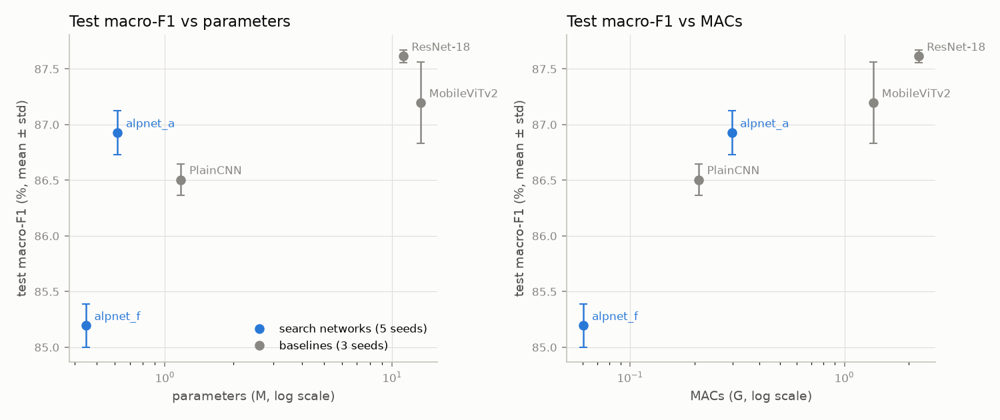
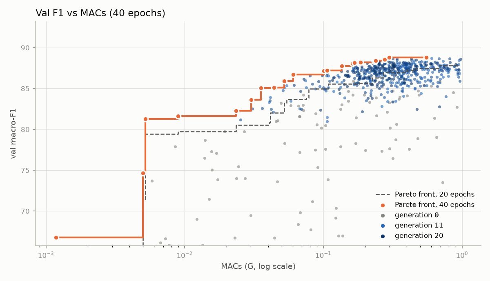
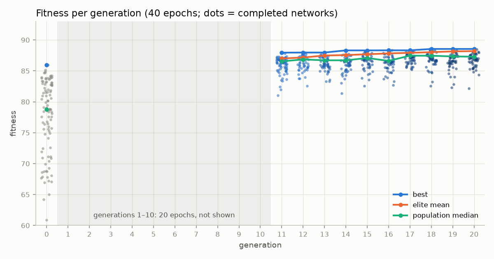

# AlpNet

AlpNet is an educational project in **neural architecture search (NAS)**: instead of designing a
convolutional neural network (CNN) by hand, a program designs it. It writes each network down as a list
of choices (how many layers, which blocks, how wide, which kernel sizes…), trains it on an image
classification task and scores it. A **genetic algorithm** then evolves these lists: the best networks
are kept, new ones are made by mixing and slightly changing them, and over many generations the networks
get better. The goal is a network that is both accurate and small. The search, the search space and the
training pipeline are written from scratch; the ResNet-18 and MobileViTv2 baselines come from torchvision
and timm.

In detail: the search is a **(μ + λ) genetic algorithm with ageing**. It uses truncation selection,
uniform crossover and random-resetting mutation. A survivor is also removed at random once it is older
than an age threshold, an idea taken from regularized (aging) evolution. The fitness is val macro-F1
minus a penalty on parameters and MACs. The task is `alpnet15_v1`, a 15-class, 1×64×64 grayscale dataset
built for this project (medical tissue, animals, vehicles and scenes). The repository contains all of
it: the dataset pipeline, the block library, the genotype and decoder, the training loop, the early
stopping rules, the GA and the analyses. [How the project was built](#how-the-project-was-built-step-by-step)
explains every step and why it was done that way.

**In short:** Across 1,231 training runs (~51 GPU-hours on an RTX 5090), we identified compact CNNs with
just 0.5–0.8M parameters and 0.3–0.55 GMACs that achieve an 86.9% test macro-F1 score—matching
near-baseline performance while requiring less than one-tenth the parameters of a ResNet-18 (87.6% test
macro-F1).



`alpnet_a`: the best network by fitness; `alpnet_f`: the best network under 0.1 GMACs. All seven
selected networks: [`results/final/test_f1_vs_cost.png`](results/final/test_f1_vs_cost.png).

## Results

The final networks were chosen **by val only** from the search, then retrained from scratch with 5 seeds
with the same recipe as the baselines (40 epochs, checkpoint = the best val macro-F1 epoch). Test-set
scores, mean ± std over seeds (baselines: 3 seeds). Full table with per-group scores:
[`results/final/summary.md`](results/final/summary.md); genotypes: [`results/final/networks.json`](results/final/networks.json).

| Model | Chosen as | Params | MACs | Train time / run | Val F1 | **Test macro-F1** | Test vehicle | Test scene |
|---|---|---|---|---|---|---|---|---|
| B3 ResNet-18 | baseline | 11.18M | 2.22G | 3.1 min | 89.04 | **87.61 ± 0.06** | 81.30 | 77.83 |
| B4 MobileViTv2-1.75 | baseline | 13.37M | 1.37G | 6.4 min | 88.58 | 87.20 ± 0.36 | 79.85 | 77.56 |
| **alpnet_a** | best fitness, M | **0.62M** | 0.30G | 3.8 min | 88.77 | **86.93 ± 0.20** | 79.33 | 77.51 |
| alpnet_d | 3rd fitness | 0.52M | 0.32G | 4.9 min | 88.46 | 86.90 ± 0.25 | 79.06 | 77.84 |
| alpnet_g | L (≤ 1 GMACs) | 0.80M | 0.55G | 7.4 min | 88.74 | 86.84 ± 0.24 | 79.72 | 77.60 |
| B2 PlainCNN | baseline | 1.18M | 0.21G | 0.7 min | 88.18 | 86.51 ± 0.14 | 78.80 | 76.70 |
| alpnet_c | 5th fitness | 0.43M | 0.23G | 3.8 min | 88.21 | 86.44 ± 0.27 | 78.47 | 76.82 |
| alpnet_e | 4th fitness | 0.30M | 0.18G | 4.1 min | 87.82 | 86.08 ± 0.13 | 77.76 | 76.38 |
| alpnet_b | 2nd fitness | 0.30M | 0.18G | 3.6 min | 87.75 | 86.07 ± 0.11 | 78.20 | 76.26 |
| alpnet_f | S (≤ 0.1 GMACs) | 0.45M | **0.06G** | 3.5 min | 86.87 | 85.19 ± 0.19 | 76.21 | 74.78 |
| B1 LeNet | baseline | 0.34M | 0.0025G | 0.5 min | 75.76 | 74.22 ± 1.24 | 58.70 | 60.69 |

**B1–B4 are the baselines:** reference networks, trained with the same recipe, that the searched
networks are compared against. Their numbers were assigned before any training, by the role each was
meant to play (weak, medium, strong, modern), not by score; see [Baselines](#3-baselines-what-to-beat).
S / M / L are the best networks on the Pareto front within 0.1 / 0.5 / 1 GMACs.

The best network, `alpnet_a` (stem 3×3, then four stages; `w` width, `d` depth, `k` kernel):

```
s64 MBConv     concat  d1 w96  k1 BN
s32 bottleneck add     d2 w128 k3 LayerNorm
s16 conv       concat  d5 w64  k3 BN
s4  double conv concat d2 w96  k1 BN
```

What the numbers say:
- **Small networks come close to the big baselines.** The best three (`a`, `d`, `g`) are equal within
  noise, 0.7 points below ResNet-18 with 14–22× fewer parameters and 4–7× fewer MACs; `g` and `d` have
  the lowest cross-group error of all models (2.25% and 2.31% vs 2.47% for ResNet-18).
- **The Pareto front saturates around 0.3 GMACs.** The L network (0.55 GMACs) is no better than the M
  one (0.30); the S network (0.06 GMACs) loses 1.7 points.
- **The cost penalty has a price.** The 2nd and 4th by fitness (0.30M parameters) are 0.4 points below
  PlainCNN: the fitness traded accuracy for size, as designed (`a = b = 0.3`, see
  [the fitness function](#6-choosing-the-best-the-fitness-function)).
- **MACs are a poor proxy for time.** Every search network trains slower than ResNet-18 despite 4–37×
  fewer MACs (depthwise convolutions, concatenation, SE). Time was deliberately left out of the fitness
  (it cannot be measured reliably under load), and it shows.
- **Little winner's curse from seed luck.** Retrained with 5 seeds, the chosen networks lose on average
  0.14 points of val F1 against the single training they were chosen by (at most 0.46). Across the 5
  seeds, a final network's test macro-F1 spans 0.3–0.6 points (std 0.11–0.27). The retraining also
  switches from the fused AdamW kernel of the search to the standard one (the same algorithm, so only
  floating-point differences). The val–test gap is ~1.6–1.9 points for
  the search networks vs ~1.4 for ResNet-18 and MobileViT; most of it is the domain gap of the medical
  group (val and train come from the same slides, test from other patients), the extra 0.2–0.4 may be the
  architecture fitting the val samples, which this design cannot separate.
- **The newest baseline is not the best.** MobileViTv2 (B4) ends below ResNet-18, which is plausible:
  transformer blocks usually need more data than 2000 small grayscale images per class.

### The search



Val F1 against MACs for every network trained with 40 epochs (orange: the 40-epoch Pareto front, dashed:
the 20-epoch front of the first phase). At the same cost, 40 epochs give +1.5–2 points, more for small
networks.



| Generation | Epochs | Best fitness | Elite mean | Median | Elite bar |
|---|---|---|---|---|---|
| 1 | 20 | 85.51 | 81.71 | 81.65 | 80.38 |
| 10 | 20 | 86.67 | 86.25 | 85.47 | 85.87 |
| 11 | 40 | 87.95 | 87.01 | 86.53 | 86.39 |
| 20 | 40 | 88.55 | 88.20 | 87.29 | 87.96 |

The best stopped improving after generation 18 while the elite mean rose slowly: the search was close to
saturation. Full reports: [`results/search/analysis_40ep/analysis.md`](results/search/analysis_40ep/analysis.md)
(phase 2) and [`results/search/analysis_20ep/analysis.md`](results/search/analysis_20ep/analysis.md) (phase 1).

**What the search learned** (val F1; three views with their own biases: the 100 random networks of
generation 0, all completed networks, and mutation pairs — a child against its parent, where only a few
genes changed; directions, not proof):
- Robust (all networks and generation 0, both phases; the mutation pairs agree where there were enough
  flips): **BatchNorm, SE, concat (DenseNet-style) connections, double-conv bodies and BlurPool
  downsampling** help; **Sigmoid, global max pooling in the head and extra FC layers in the head** hurt;
  wider, deeper networks with an early first stage are better before the size penalty.
- Mixed: Mish looks good across networks but not in the mutation pairs (it probably rode along with good
  parents); LayerNorm is negative in the regressions but positive in the 20-epoch mutation pairs.
- Over the generations the population converged on a **3×3 stem** (100% of the best 30), **3×3 kernels**
  (55% of the stages of the best 30 vs 26% at random), BatchNorm (81%), concat connections (69%) and a
  GAP‖GMP head; 7×7 kernels almost disappeared at 40 epochs (3%).
- Longer training changed what wins: at 20 epochs the best networks were bigger (0.6–2.9M) with 7×7
  bottleneck stages; at 40 epochs smaller networks catch up, and the effect of size on F1 drops
  (ridge coefficient of log2 params 1.04 → 0.29).
- **Mutation beat crossover per child:** 12% of mutation children beat their best parent at 40 epochs vs
  6% of crossover children (19% vs 12% at 20 epochs).
- The early stopping rules, calibrated on generation 0, saved only 1–2% of the training time in the GA,
  much less than on generation 0's random networks: the children of elites are rarely bad enough to cut.
- After the search, the sealed test scores agree with val over all networks (Spearman 0.96) but not
  within the best 30 (0.45): their differences are below the seed noise
  ([`results/search/test_after_search.md`](results/search/test_after_search.md)).

## How the project was built, step by step

Each step below says what was decided, why, and what was measured on the way. The order is the order in
which the project was built.

### 1. The dataset: sources and classes

**Goal:** a dataset that is hard enough for differences between architectures to show, small enough to
train ~1000 networks on one GPU, and clean enough that the test score means something. The task: 15
classes in four semantic groups, real photographs only (no drawings or renders).

**The trap of a mixed dataset.** When classes come from different datasets, a network can learn *which
dataset* an image comes from instead of what is in it: every source has its own signature (camera,
compression, resolution, colours). If each class came from its own source, the task would reduce to
recognizing the source. So **each group comes from a single source**: the source signature can give away
the group, but not the class, and the real work is telling the classes of a group apart.

| Group | Source | Classes | Train / val / test split |
|---|---|---|---|
| medical | PathMNIST (MedMNIST+ 128px; colorectal cancer histology) | ADI, LYM, NORM, TUM | test from 50 other patients (CRC-VAL-HE-7K); train/val from the same slides |
| animal | AFHQ v2 (512px animal faces) | cat, dog, wild | official test + held out from train |
| vehicle | Open Images V7, box crops | Airplane, Boat, Car, Truck | 60/20/20 by photo, so crops of one photo stay in one split |
| scene | Places365-Standard (256px) | desert_sand, forest_broadleaf, mountain, ocean | random |

**Easy, medium and hard pairs.** Between groups the task is easy (tissue vs airplane). The difficulty is
set inside the groups, on purpose with a mix of levels so that a weak network and a strong network end
up far apart:

| Level | Pairs |
|---|---|
| easy | ADI (white fat tissue), Airplane↔Boat, desert↔forest |
| medium | LYM, cat↔dog, mountain↔ocean |
| hard | **TUM↔NORM** (without the stain colour only the tissue structure is left), **cat↔wild** (lions, tigers, leopards), **Car↔Truck** (pickups and vans sit in between) |

**How many images.** 2000 train / 500 val / 500 test per class: 30,000 / 7,500 / 7,500 in total, the
same for every class (balanced). The test set decides how small a difference can be trusted: with 7,500
test images the standard error of an accuracy near 87% is about ±0.4 points. That is the uncertainty of
one score, not a threshold for a difference between two networks: both are measured on the same images,
and the seed adds its own spread. No paired test was run, so small differences in the tables are not a
ranking. 500 test images per class was a hard requirement, and it ruled sources out.

**Sources considered and dropped.** EuroSAT (only 64×64, no margin for the crop below; neighbouring
satellite tiles are near-duplicates), Intel Image Classification and Animals-10 (too few images per class
for 2000 / 500 / 500, known label noise), iNaturalist (an independent split could not be confirmed),
STL-10 for vehicles (1300 images per class), COCO crops (Open Images was chosen instead).

**Cleaning.**
- Open Images boxes: no depictions (drawings, toys), no group boxes, no photos taken from inside the
  object (`IsDepiction = IsGroupOf = IsInside = 0`); a square crop with 10% context around the box, crop
  side ≥ 80 px, at most 2 boxes per class per photo.
- Images with a side under 80 px or almost a single colour are rejected.
- Near-duplicates are removed with a perceptual hash (pHash, Hamming distance ≤ 4) across all splits of a
  group, so the same picture cannot be in train and test.
- Known leftovers: label noise (a portrait in a Car box, a harbour in desert_sand) and pairs that are
  ambiguous by nature (boats at sea vs ocean).

**Checking it with the baselines** (step 3) before freezing it: weak and strong networks are far apart
(LeNet 74.2 vs ResNet-18 87.6 test F1), animals saturate (~99%), and most of the difference between models
comes from the vehicle and scene groups. Cross-group errors are low (~2.5%) and almost all
vehicle↔scene (Boat↔ocean, Airplane↔desert), i.e. semantic overlap. The dataset was then **frozen** as
`alpnet15_v1` (content hash `86375ee0…`); every later experiment uses this version.

The dataset itself is **not distributed** (see [Licenses](#licenses-and-attribution)); the scripts
rebuild it deterministically from the sources (same `content_sha256`).

### 2. The input format: resolution and channels

Every image is **1×64×64: one grayscale channel, 64×64 pixels.**

- **Why 64×64.** A CNN halves the resolution several times; at 64×64 there is room for four halvings
  (64 → 32 → 16 → 8 → 4), which is exactly what the search needs to compare downsampling methods,
  strides and pooling, and stages at different resolutions. 32×32 leaves only three halvings and little
  detail (tissue texture, small vehicles). 128×128 multiplies the compute and the activation memory of
  every layer by 4, and with it the time of the whole search: ~1000 trainings would no longer fit in a
  few days on one GPU.
- **Why grayscale.** Without colour the classes must be told apart by shape and texture, not by a
  dominant colour (yellow desert, green forest, the pink-purple stain of the tissue slides). This makes
  the within-group pairs harder and the architecture matter more. One input channel also makes the
  input layer cheaper. Conversion: PIL `"L"` (ITU-R BT.601 luma).
- **Only downscaling.** Every source is at least 80 px and is only shrunk (center square crop, Lanczos).
  Upscaling a small source (CIFAR's 32×32 to 64×64, for example) would add interpolation blur, another
  source signature.
- **Stored at 80×80, trained at 64×64.** Training takes a random 64×64 crop (a small shift) and a
  horizontal flip (every class here is mirror-invariant); val and test take the center crop. The whole
  dataset is 45,000 × 80×80 bytes ≈ 290 MB, small enough to **live on the GPU** as uint8: cropping,
  flipping and normalizing happen there, with no data-loading workers (slow on Windows) and no CPU
  bottleneck.

### 3. Baselines: what to beat

Before searching, four reference networks were trained with the same recipe as everything later, each
with 3 seeds. They answer three questions: is the dataset well posed, how much does the architecture
matter on it, and what does the search have to beat.

| | Model | Role |
|---|---|---|
| B1 | LeNet: 2 × (5×5 conv + maxpool), 3 FC layers; no normalization, no residuals | weak reference |
| B2 | PlainCNN: VGG-style, 4 stages × 2 (3×3 conv, BatchNorm, ReLU), maxpool, global average pooling, FC | medium reference |
| B3 | ResNet-18 with a stem for small images (3×3, stride 1, no maxpool, 1 input channel) | strong classic reference |
| B4 | MobileViTv2-1.75 (timm), stem stride 1 | modern CNN/transformer hybrid |

The numbers were given by role, before training. What the baselines showed (test, 3 seeds; full table
in [`results/baselines/summary.md`](results/baselines/summary.md)):
- **The dataset separates networks:** weak ↔ medium is a 12-point gap, medium ↔ strong ~1.1 points while
  the seed standard deviation is only 0.1–0.2 points.
- **The metric:** macro AUROC saturates at ~99% and ranks the models wrongly (B2 above B3), and a
  checkpoint chosen by val AUROC erased the B2–B3 gap. So the checkpoint and the search fitness use
  **val macro-F1**.
- **The checkpoint epoch:** the best val F1 epoch was always 35–39 of 40: under a cosine schedule the
  real gain comes at the end. This shaped the early stopping rules (step 8).
- **The budget of the search:** B2 (1.2M parameters, 0.21 GMACs) is inside the search budget, B3 and B4
  are outside. The question the search asks: is there a network as good as ResNet-18 within at most
  ~2.5× B2's parameters and ~5× its MACs?

### 4. The search space: blocks and genes

**A network as a list of genes.** A genotype is a flat dictionary of **76 genes**: a stem, **five slots
at fixed downsampling levels (nominal resolutions 64, 32, 16, 8, 4; `valid` padding can shrink a map
by a few pixels)** and a head. Each slot is a stage that can be switched on or
off; every block in a stage shares the stage's genes (the first block does the downsampling). Genes per
block instead of per stage would multiply the gene count by ~5 and make crossover and mutation little
better than random search.

| Gene (per stage) | Options |
|---|---|
| active | on / off |
| depth | 1–6 blocks |
| width | 16, 24, 32, 48, 64, 96, 128, 192, 256, 384 |
| downsample | maxpool 2×2, maxpool 3×3 (overlapping), average pool, strided conv, BlurPool |
| block body | conv, double conv, bottleneck, depthwise-separable, MBConv, ConvNeXt |
| connection | none, add (ResNet), concat (DenseNet) |
| kernel | 1, 3, 5, 7 |
| padding | same, valid |
| activation | ReLU, LeakyReLU, ELU, GELU, SiLU, Mish, Hardswish, Tanh, Sigmoid, Identity |
| normalization | BatchNorm, LayerNorm (over channels), none |
| order | conv → norm → act, or pre-activation (norm → act → conv) |
| expansion | 2, 4 (bottleneck, MBConv, ConvNeXt) |
| SE (squeeze-and-excitation) | yes / no |
| growth rate | 16, 32, 48 (concat only) |

Sigmoid and Identity are there as negative controls: options the search should learn to avoid.

| Body | Structure (`w` stage width, `k` kernel, `e` expansion) |
|---|---|
| conv | k×k |
| double conv | k×k → k×k |
| bottleneck | 1×1 (→ w/e) → k×k → 1×1 (→ w) |
| depthwise-separable | depthwise k×k → 1×1 |
| MBConv | 1×1 (→ e·C) → depthwise k×k → [SE] → 1×1 (→ w) |
| ConvNeXt | depthwise k×k → norm → 1×1 (→ e·w) → act → 1×1 (→ w) |

- **Stem:** kernel 3 / 5 / 7 and a width, always at 64×64 with stride 1 (the slots do the downsampling).
- **Head:** pooling (global average, global max, both concatenated, or flatten), then 0–3 fully connected
  layers of one width (64–512), then the output layer; dropout fixed at 0.3.
- **Connections:** *add* gets a 1×1 projection when the shapes differ and its last norm starts at zero;
  *concat* appends `growth` channels per block and a 1×1 transition brings the stage back to its width.

**Why slots at fixed resolutions.** Crossover needs to know which part of one parent matches which part
of the other. Matching stages by position breaks when the parents have different numbers of stages; a
single cut point keeps big chunks but mixes little. With slots, slot 16 of one parent always meets slot
16 of the other, by construction. The genes of a switched-off slot stay in the genotype (hidden genes),
are inherited, and come back if a mutation switches the slot on. The price: one block type per
resolution.

**The decoder never rejects a genotype; it repairs it.** It tracks the shape layer by layer, keeps the
resolution ≥ 4×4, switches a slot on if none is active, turns `valid` padding into `same` where it would
leave no room, and picks the weight initialization by activation. Every repair is deterministic, so the
same genotype always builds the same network. It also writes a **canonical form**: the network without
the genes that have no effect (the expansion of a plain conv, the padding of a 1×1 kernel, a
switched-off slot…). Its hash identifies the network: two genotypes that build the same network get the
same hash (used by the cache, step 8).

**Budget** (a network over it is never trained): ≤ 3M parameters, ≤ 1 GMACs, ≤ 20 GB of training
memory. Parameters and MACs do not bound the activation memory (a random network in an early, larger
budget needed 45 GB at batch 256), so memory is measured, not estimated.

**Narrowing the space for time.** After the first generation 0, three options were removed:
**kernel 11** (every kernel is now at most 7×7), **GroupNorm** and **expansion 6**. The reason was time,
not quality. The 10 slowest of 100 random networks took 54% of the training time, and the 7 slowest all
had an 11×11 depthwise convolution at high resolution. Measured on one layer (depthwise, 288 channels,
64×64, batch 256, bf16, forward + backward, channels_last): 13 ms at 7×7, 142 ms at 9×9, 195 ms at
11×11 — there is no fast cuDNN kernel above 7×7. GroupNorm showed no benefit and was slower than
BatchNorm; expansion 6 was the largest memory and time multiplier at high resolution. The networks of
that first generation 0 fell outside the new space, so generation 0 was drawn again (all 100 networks;
keeping the 31 that stayed inside would have favoured shallow networks). See
[Limitations](#limitations).

### 5. Making new networks: the genetic algorithm

A **genetic algorithm (GA)** keeps a population of candidate solutions, keeps the fittest, and makes new
candidates from them by **crossover** (mixing two parents) and **mutation** (small random changes).
Here a candidate is a genotype, and its fitness is the score of the trained network (step 6).

The best-known evolutionary NAS method is **regularized evolution** (also called aging evolution), made
famous by Google Brain (Real et al., 2019), whose AmoebaNet reached the state of the art on ImageNet at
the time. It is simple: keep a population (e.g. 100 networks); at every step pick a few at random
(tournament selection), mutate the best of them into one child, train the child, add it, and **remove
the oldest network**, not the worst. No network lives forever, however good, so a network that got a
lucky score from one training cannot hold the population; a family of architectures survives only if
its children keep scoring well. The authors found this more robust to noisy scores than removing the
worst, and better at keeping diversity.

AlpNet keeps the generations of a classic GA and borrows only the ageing idea:

- **(μ + λ) scheme, μ = 20, λ = 50** (terms as in Eiben & Smith, 2015): every generation the 20 fittest
  of parents + offspring survive (**truncation selection**); they are called the elites.
- **Offspring:** 30 by **uniform crossover** of two elites drawn uniformly at random (each gene from
  parent 1 / parent 2 / re-sampled at random with p = 0.45 / 0.45 / 0.1) and 20 by **random-resetting
  mutation** alone, one per elite (each gene re-sampled with p = 0.1, about 8 of the 76 genes).
- **Duplicate elimination:** an offspring whose network was already trained (same canonical hash), or
  that is over budget, is rejected and drawn again (at most 20 tries, then a random genotype), so every
  generation trains 50 new networks.
- **Ageing:** an individual's age is the number of generations it has survived; offspring start at 0.
  An elite older than the **age threshold κ = 5** (the maximum lifespan of the (μ, κ, λ)-ES of Schwefel &
  Rudolph, 1995, made soft here: no hard limit) is removed with probability 0.3 per generation, the
  fittest included (**stochastic ageing**, cf. Oliveto & Sudholt, 2014). If it stays in the top 20, it
  lives 5 + 1/0.3 ≈ 8 generations on average.
  No result is lost: the history keeps every evaluation.
- **Generation 0:** 100 random networks (every gene uniform among its options, within budget), trained
  fully without any early stopping.

**Why this design and not plain regularized evolution.** Under plain truncation selection a good
individual can survive forever, and with a noisy fitness (each network is trained once) a lucky
evaluation keeps its place for the rest of the run; ageing fixes that. Regularized evolution itself is
steady-state (one child per step) and uses tournament selection. The generational scheme trains 50
networks per generation as one batch of work, is simple to resume after a crash and easy to diagnose
generation by generation. A lucky evaluation leaves the population a few generations after its lifespan
ends, while its genes live on in its offspring if they are really good.

**Crossover and mutation together.** Mutation takes small, controlled steps; crossover can combine good
parts but makes large, often destructive jumps. Both are used, and each elite gets a mutation child. In
this run mutation children were more likely to beat their best parent (12% vs 6% at 40 epochs).

### 6. Choosing the best: the fitness function

```
fitness = val macro-F1 − 0.3·log2(params / 1M) − 0.3·log2(MACs / 0.1G)
```

(F1 in points, 0–100; params floored at 0.1M and MACs at 0.01G.)

- **Macro-F1 on val**, not accuracy and not AUROC: every class counts equally, and AUROC saturated on
  the baselines (step 3).
- **A cost penalty**, because the goal is a small network and because without it a search drifts to the
  largest networks the budget allows and teaches little. The penalty is logarithmic: what matters is the
  ratio, not the difference. `0.3` reads as "points of F1 a network must gain to double its parameters"
  (and the same for MACs): doubling both must buy 0.6 points, 10× both about 2 points. Example: B2
  PlainCNN (86.5, 1.18M, 0.21G) → 86.5 − 0.3·0.24 − 0.3·1.07 ≈ 86.1. A network at the top of the budget
  (3M, 1G) needs ~1.1 points more F1 than B2 to beat it, about the B3 − B2 gap.
- **Floors:** below 0.1M parameters and 0.01 GMACs there is no further bonus (at most +2 points), so tiny
  networks cannot game the fitness.
- **No time in the fitness:** training time depends on what else runs on the GPU and cannot be measured
  reliably; MACs is the proxy. Its blind spot is that it understates depthwise convolutions and
  concatenation (see the results).
- **Recomputable:** F1, parameters and MACs are stored for every network, so another `a`, `b` can be
  tried later and the Pareto front drawn without retraining.
- **Test scores never steer the search.** Each candidate is tested once, at the end of its training, and
  the score was written only to its own sealed file, opened after the search ended; selection, early
  stopping and the choice of the final networks use val only.

### 7. Hyperparameters

The training recipe is **fixed and the same for every network** (baselines included): learning rate and
weight decay are not genes, so fitness differences come from the architecture alone. Two exceptions:
the heads (each baseline keeps its standard head) and the AdamW kernel (fused in the search, step 8).

| Training (all networks) | Value |
|---|---|
| optimizer | AdamW, lr 2e-3, weight decay 0.05 (none on biases and norms) |
| schedule | 2 epochs linear warmup, then cosine to zero |
| epochs | 40 (baselines, final networks); 20 or 40 in the search (step 8) |
| batch | 256 (evaluation 256) |
| loss | cross-entropy with label smoothing 0.1 |
| precision / layout | bf16 autocast, channels_last |
| augmentation | random 64×64 crop from 80×80, horizontal flip p = 0.5 |
| head dropout | 0.3 (search networks, PlainCNN); none in LeNet and ResNet-18, 0 in MobileViTv2 |
| checkpoint | the epoch with the best val macro-F1 |
| seed | the same for every search candidate: same initialization seed and the same data order |

| Search | Value |
|---|---|
| generation 0 | 100 random networks |
| elites μ (`K`) | 20 |
| offspring λ | 30 crossover (`C`) + 20 mutation (`M`) |
| crossover `p1 / p2 / pm` | 0.45 / 0.45 / 0.1 per gene |
| mutation rate `qm` | 0.1 per gene |
| age threshold κ (`A`) / death probability (`DR`) | 5 generations / 0.3 |
| generations | 20: 1–10 at 20 epochs, 11–20 at 40 epochs |
| fitness `a`, `b` | 0.3, 0.3 |
| budget | 3M parameters, 1 GMACs, 20 GB training memory |

`pm = qm = 0.1` was not set lower on purpose: the elites pass on unchanged, so a good solution is not
lost, and the diversity comes from this rate. The early stopping thresholds are in step 8 and in
[`results/search/search.yaml`](results/search/search.yaml), the config of the main run.

### 8. Saving compute

A full 40-epoch training of a random network took 2.4 minutes at the median and 4.8 on average; 1000
of them one after another would have taken ~80 hours. Most of what follows exists to cut that.

- **Data on the GPU** (step 2): no data loading at all during training.
- **bf16 and channels_last** for every training; MACs are counted on PyTorch's meta device (no memory,
  no compute, ~0.1 s per genotype), so the budget is checked before anything is trained.
- **The search recipe:** the test set is evaluated once at the end instead of every epoch (the checkpoint
  weights are kept on the GPU; same scores, ~8.5% of every epoch saved), and AdamW runs as one fused
  kernel (training ~35% faster on most networks). Together an epoch got ~38% shorter.
- **The cache: never train the same network twice.** Results are keyed by the hash of the canonical
  form (step 4), plus the decoder version, the dataset's content hash and the recipe. Two genotypes that
  build the same network are trained once, and a child that is already in the history is drawn again
  instead of being retrained. A test (`test_same_function_same_hash`) builds equivalent variants of
  random genotypes and fails if two networks with the same output get different hashes.
- **The two-phase epoch schedule: first 20, then 40 epochs.** A GA does not need absolute scores, only
  the ranking: who becomes an elite, who dies. On 30 random networks the ranking after a 20-epoch
  training agreed with the 40-epoch ranking at Spearman 0.96 (95% interval 0.89–0.98), in half the time
  (10 epochs: 0.89). But as the GA proceeds the children of the elites look alike and their scores get
  close, and close networks are harder to rank: on the 100 networks of generation 0, the 20-epoch ranking
  agreed at 0.97 overall but only at 0.71 within the best 30. Hence 20 epochs for exploration in
  generations 1–10, and 40 epochs for fine selection in generations 11–20. A network's 20-epoch F1 is
  ~4 points below its 40-epoch F1, so the two are never compared: generation 0 is trained with both, and
  at the switch the elites, the best 20 of everything trained at 20 epochs and the Pareto front are
  retrained with 40 epochs. The final results come from 40-epoch scores only.
- **Early stopping (pruning)** in stages, on the best val F1 so far (not the last epoch: val fluctuates
  under cosine):
  1. hard rules: NaN, out of memory, not learning (train loss still ≈ ln 15, the loss of a uniform guess,
     at epoch 3);
  2. an absolute floor (40 epochs: val F1 < 0.50 at epoch 10);
  3. a percentile of generation 0's curves at the same epoch (the median-stopping idea of Google Vizier;
     here the bottom 20%);
  4. "can it still reach the elite bar?": the candidate's F1 plus the largest gain seen in generation 0
     from that epoch to the end, minus its cost penalty, against the fitness of the 20th elite;
  5. **patience**: stop when val F1 has not improved for 5 epochs, but only from epoch 30 (2 epochs from
     epoch 15 at 20 epochs). On the baselines, patience at every epoch saved 1.8 epochs on average and
     cut ResNet-18 at epoch 18, 3.8 points too early; the real gain comes after the learning rate drops.

  The thresholds were **calibrated on generation 0** (100 networks fully trained, never cut): the setting
  that saves the most time while cutting none of its best 30 networks. A network cut early is recorded
  with its reason and cannot become an elite. On generation 0 the chosen rules would have saved 17–18%
  of the time; in the GA only 1–2%, because the children of elites are rarely bad enough to cut.
- **Narrowing the search space** (step 4): removing 11×11 kernels, GroupNorm and expansion 6 was
  expected (a rough estimate, not measured) to cut the mean training time of a random network by
  40–50%.
- **Resumable, crash-safe runs.** The development PC restarts under load from time to time. The state is
  saved every generation, every record is forced to disk, and the same command continues a stopped run
  without retraining finished candidates. The main run was stopped twice by hand and resumed without
  losing work.
- One candidate at a time on the GPU. A pool of parallel workers was designed (memory probe, scheduler
  by free memory) but not built: the fastest 61% of networks, the only ones it would speed up, are 23%
  of the time.

## Limitations
- One search run with one GA seed; the result depends on the GA's luck too.
- Candidates were trained with one seed during the search, so small differences between two candidates
  are not a ranking (the final networks were retrained with 5 seeds for this reason). No paired test or
  confidence interval for the differences between the final networks was computed.
- **No comparison runs.** A same-budget comparison with regularized evolution, random search or Optuna
  was planned only if budget remained; it was not run. The claims are about this search, not about this
  GA being better than the alternatives.
- **The search space was narrowed for time.** Kernels above 7×7 (11×11 was in the space, 9×9 was
  measured and is just as slow), GroupNorm and expansion 6 were removed, so architectures using them were
  not searched. In the first generation 0, networks with an 11×11 kernel had a higher val F1 overall
  (80.7 vs 77.1), though not when it was used at 32×32 and above (78.1 vs 78.9). Dilation and stochastic
  depth were never in the space.
- One block type per resolution (the price of the slots), and all blocks of a stage share their genes.
- MACs stand in for time in the fitness; the found networks train slower than their MACs suggest.
- The test set was used in the baseline step (choosing the checkpoint metric, freezing the dataset), so
  one cannot say it was used in no design decision; in the search its scores were sealed and steered
  nothing.
- Group = source in this dataset: a model could use the source's signature to tell the groups apart.
  Cross-group errors are low (~2.5%) and almost all vehicle↔scene, but this does not prove there is no
  shortcut.
- The medical val set comes from the same slides as train and is optimistic (~99% vs ~95% on test).

## How to run

Requirements: Python 3.11, a CUDA GPU with bf16 (developed on an RTX 5090, 32 GB; the search caps
PyTorch at 20 GB: on a smaller GPU pass `--mem-cap` with less to `run_pipeline.py`, which makes it
another search, as the networks that run out of memory change), ~50 GB of disk for the raw data. A
class short of its image count stops the dataset build (a failed download, for example).

```bash
pip install torch torchvision --index-url https://download.pytorch.org/whl/cu132
pip install -r requirements.txt
```

**1. Build the dataset** (~45 GB download, then `data/processed/alpnet15_v1.npz`):
```bash
python scripts/download_raw.py
python scripts/download_openimages.py
python scripts/build_dataset.py
```

**2. Baselines** (4 models × 3 seeds) and their table:
```bash
python scripts/train_baseline.py
python scripts/summarize_runs.py --prefix <the run folders' date prefix>
```

**3. The search** — generation 0, the calibration of the stop rules, the analyses of generation 0 and the
20-generation GA, as one resumable command (~2–3 days on one GPU; the same command continues after a stop
or a crash, and more generations in `<out>/search.yaml` extend a finished search):
```bash
python scripts/run_pipeline.py --out runs/main
```
A short end-to-end trial of the GA (tiny generations, 3–4 epochs) and a progress report while a
search runs:
```bash
python scripts/run_search.py --out runs/search_trial --config configs/search_trial.yaml
python scripts/search_report.py runs/main/search
```

**4. Analyses** (CPU, val only), then open the seal after the search:
```bash
python scripts/analyze_search.py runs/main/search --epochs 40
python scripts/analyze_test.py runs/main/search
```

**5. Final evaluation:** retrain networks chosen by val (their hashes from the analysis report) with 5
seeds and compare them with the baselines (`--baselines`: the date prefix of their run folders):
```bash
python scripts/train_final.py runs/main/search <hash> <hash> ... --seeds 0 1 2 3 4 --baselines <prefix> --out runs/final --chart alpnet_a alpnet_f
python scripts/export_results.py runs/main runs/final --baselines <prefix>   # the copy in results/
```
To build one of the final networks in your own code:
```python
import json
from alpnet.models.decoder import decode
net = json.load(open("results/final/networks.json"))[0]
model = decode(net["genotype"]).build()   # alpnet_a, randomly initialized
```

Tests: `pip install pytest`, then `python -m pytest tests`. Five tests need a CUDA GPU (four of them also
the built dataset) and are reported as skipped without it; every test file also runs directly with
`python tests/test_<name>.py`.

### Repository layout
```
alpnet/data/      source adapters, preprocessing, the GPU loader with augmentation
alpnet/models/    baselines, the block library, the genotype decoder
alpnet/train/     the training loop, metrics, stop rules
alpnet/search/    the search space, the GA, the fitness
configs/          search configs
scripts/          download, build, train, search and analysis scripts
tests/
results/          the reports and charts of the main run (search, generation 0, baselines, final)
```
`results/search/results.jsonl.gz` holds every evaluation of the main run (genotype, canonical form, cost,
val curve and scores), `test_sealed.jsonl.gz` their sealed test scores, `generations.jsonl` the
per-generation diagnostics and `ga_state.json` the last population; `results/final/runs.jsonl.gz` holds
every final and baseline run per seed. The analyses run on this copy without the raw data, e.g.
`python scripts/analyze_search.py results/search --epochs 40 --out <dir>`.

## References

Search and evolutionary computation:
- A. E. Eiben, J. E. Smith, *Introduction to Evolutionary Computing*, 2nd ed., Springer, 2015.
- H.-P. Schwefel, G. Rudolph, "Contemporary Evolution Strategies", *ECAL 1995*, LNCS 929, pp. 893–907,
  Springer, 1995. Introduces the (μ, κ, λ)-ES with a maximum lifespan κ.
- E. Real, A. Aggarwal, Y. Huang, Q. V. Le, "Regularized Evolution for Image Classifier Architecture
  Search", *AAAI 2019*.
- P. S. Oliveto, D. Sudholt, "On the Runtime Analysis of Stochastic Ageing Mechanisms", *GECCO 2014*,
  pp. 113–120.
- D. Golovin et al., "Google Vizier: A Service for Black-Box Optimization", *KDD 2017* (median stopping).

Baselines and blocks:
- Y. LeCun, L. Bottou, Y. Bengio, P. Haffner, "Gradient-Based Learning Applied to Document Recognition",
  *Proc. IEEE*, 1998 (LeNet).
- K. Simonyan, A. Zisserman, "Very Deep Convolutional Networks for Large-Scale Image Recognition",
  *ICLR 2015* (VGG).
- K. He, X. Zhang, S. Ren, J. Sun, "Deep Residual Learning for Image Recognition", *CVPR 2016* (ResNet,
  bottleneck); "Identity Mappings in Deep Residual Networks", *ECCV 2016* (pre-activation).
- S. Mehta, M. Rastegari, "Separable Self-attention for Mobile Vision Transformers", *TMLR 2023*
  (MobileViTv2).
- G. Huang, Z. Liu, L. van der Maaten, K. Q. Weinberger, "Densely Connected Convolutional Networks",
  *CVPR 2017* (concat connections).
- M. Sandler et al., "MobileNetV2: Inverted Residuals and Linear Bottlenecks", *CVPR 2018* (MBConv).
- Z. Liu et al., "A ConvNet for the 2020s", *CVPR 2022* (ConvNeXt).
- J. Hu, L. Shen, G. Sun, "Squeeze-and-Excitation Networks", *CVPR 2018* (SE).
- R. Zhang, "Making Convolutional Networks Shift-Invariant Again", *ICML 2019* (BlurPool).

## Licenses and attribution

The code is released under the [MIT License](LICENSE).

The dataset is built from the sources below, each under its own terms; it is **not redistributed** here,
and anything you build from it inherits their restrictions (AFHQ and Places365 are for non-commercial
use only).

| Source | License / terms | Please cite |
|---|---|---|
| PathMNIST (MedMNIST v2), from NCT-CRC-HE-100K and CRC-VAL-HE-7K | CC BY 4.0 | J. Yang et al., "MedMNIST v2 — A large-scale lightweight benchmark for 2D and 3D biomedical image classification", *Scientific Data*, 2023; J. N. Kather et al., "Predicting survival from colorectal cancer histology slides using deep learning: A retrospective multicenter study", *PLOS Medicine*, 2019 |
| AFHQ v2 | CC BY-NC 4.0 | Y. Choi et al., "StarGAN v2: Diverse Image Synthesis for Multiple Domains", CVPR 2020; T. Karras et al., "Alias-Free Generative Adversarial Networks", NeurIPS 2021 |
| Open Images V7 | annotations CC BY 4.0 (Google LLC); images listed as CC BY 2.0 (check each image) | A. Kuznetsova et al., "The Open Images Dataset V4", *IJCV*, 2020 |
| Places365-Standard | non-commercial research and education only; images not to be redistributed | B. Zhou et al., "Places: A 10 Million Image Database for Scene Recognition", *IEEE TPAMI*, 2018 |
