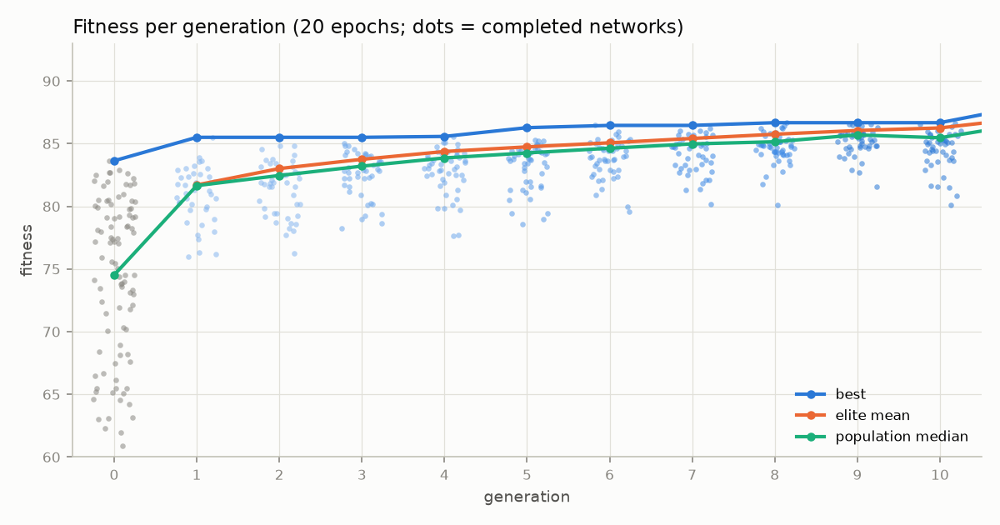
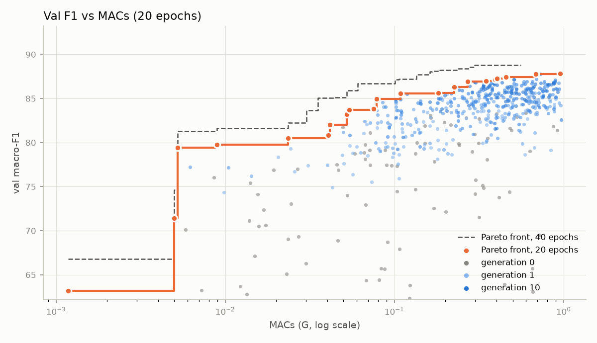
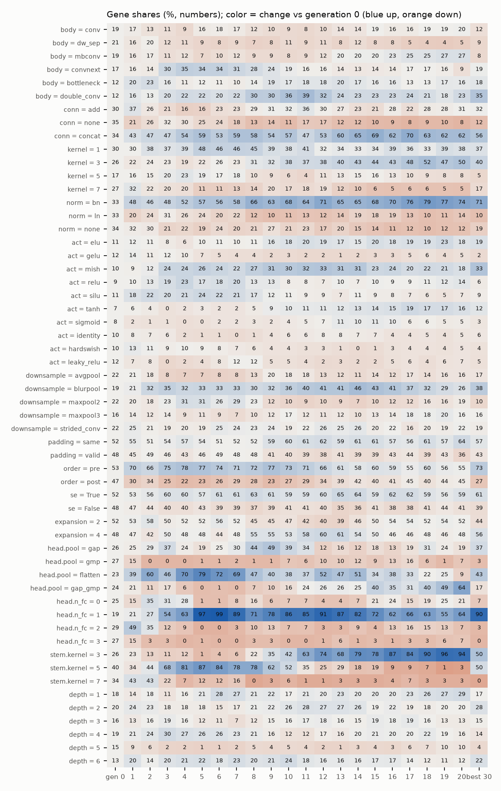
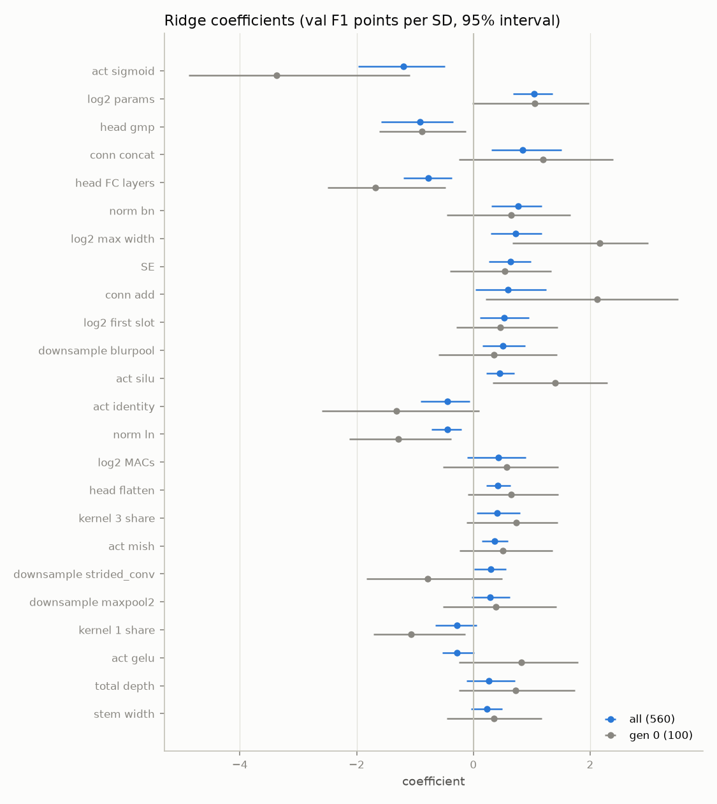

# Search analysis (runs\main_20261024\search, 20 epochs, val only)

1231 records; at 20 epochs 600, completed 560 (generation 0: 100, children: 460); finished generations 0–20. Fitness = 100·val macro-F1 − 0.3·log2(params / 1M) − 0.3·log2(MACs / 0.1G). Test scores are not read.

**Noise:** the training is not bit-deterministic and there is no repeated training at this epoch count, so the noise of one score is not measured here (one network differed by 2.5 points between two 3-epoch runs). Differences below about 1 point are not a ranking.

## 1. Progress per generation

| gen | best | elite mean | median | elite bar | completed / pruned / failed | epochs trained / full | hours | gene entropy |
|---|---|---|---|---|---|---|---|---|
| 0 | 83.64 | — | 74.52 | — | 200 / 0 / 0 | 6000 / 6000 | 6.07 | 0.98 |
| 1 | 85.51 | 81.71 | 81.65 | 80.38 | 41 / 9 / 0 | 921 / 1000 | 1.18 | 0.90 |
| 2 | 85.51 | 83.01 | 82.46 | 82.22 | 43 / 7 / 0 | 936 / 1000 | 1.10 | 0.84 |
| 3 | 85.51 | 83.75 | 83.20 | 82.93 | 45 / 5 / 0 | 964 / 1000 | 1.48 | 0.77 |
| 4 | 85.58 | 84.37 | 83.86 | 83.67 | 47 / 3 / 0 | 972 / 1000 | 1.38 | 0.72 |
| 5 | 86.28 | 84.75 | 84.26 | 84.23 | 48 / 2 / 0 | 984 / 1000 | 1.25 | 0.66 |
| 6 | 86.46 | 85.07 | 84.64 | 84.59 | 47 / 3 / 0 | 978 / 1000 | 1.22 | 0.67 |
| 7 | 86.46 | 85.42 | 84.98 | 84.99 | 44 / 4 / 2 | 934 / 1000 | 1.32 | 0.67 |
| 8 | 86.67 | 85.75 | 85.15 | 85.32 | 48 / 2 / 0 | 981 / 1000 | 1.31 | 0.67 |
| 9 | 86.67 | 86.05 | 85.70 | 85.69 | 48 / 2 / 0 | 987 / 1000 | 1.59 | 0.65 |
| 10 | 86.67 | 86.25 | 85.47 | 85.87 | 49 / 1 / 0 | 989 / 1000 | 1.58 | 0.64 |
| 11 | 87.95 | 87.01 | 86.53 | 86.39 | 49 / 1 / 0 | 3157 / 3240 | 3.96 | 0.65 |
| 12 | 87.96 | 87.16 | 86.85 | 86.85 | 49 / 1 / 0 | 1967 / 2000 | 2.74 | 0.64 |
| 13 | 87.96 | 87.48 | 86.71 | 87.17 | 48 / 2 / 0 | 1912 / 2000 | 3.48 | 0.67 |
| 14 | 88.31 | 87.55 | 86.71 | 87.28 | 49 / 0 / 1 | 1928 / 2000 | 3.03 | 0.65 |
| 15 | 88.31 | 87.69 | 87.08 | 87.46 | 48 / 2 / 0 | 1956 / 2000 | 3.46 | 0.65 |
| 16 | 88.32 | 87.83 | 86.62 | 87.59 | 48 / 1 / 1 | 1896 / 2000 | 3.16 | 0.69 |
| 17 | 88.32 | 87.91 | 87.46 | 87.70 | 48 / 2 / 0 | 1964 / 2000 | 3.25 | 0.65 |
| 18 | 88.55 | 88.03 | 87.45 | 87.80 | 47 / 3 / 0 | 1948 / 2000 | 2.84 | 0.64 |
| 19 | 88.55 | 88.15 | 87.34 | 87.94 | 47 / 1 / 2 | 1897 / 2000 | 2.72 | 0.63 |
| 20 | 88.55 | 88.20 | 87.29 | 87.96 | 48 / 1 / 1 | 1907 / 2000 | 2.68 | 0.63 |

Children not completed: pruned: reach_elite 30, pruned: percentile 5, pruned: not learning 3, oom 2. Time saved by the stop rules ≈ 0.3 h of 13.8 h (2%; the rest of a cut training estimated at its own speed).

## 2. The best networks (20 epochs)

| # | fitness | val F1 | params | MACs | gen | origin | architecture |
|---|---|---|---|---|---|---|---|
| 1 | 86.67 | 87.17 | 0.62M | 0.507G | 8 | crossover | s64 mbconv/add d1 w128 k5 bn | s16 double_conv/none d2 w96 k3 ln | s4 bottleneck/concat d2 w24 k1 bn |
| 2 | 86.64 | 87.17 | 0.67M | 0.507G | 10 | mutation | s64 mbconv/add d1 w128 k5 bn | s16 double_conv/none d2 w96 k3 ln | s4 bottleneck/concat d2 w64 k1 bn |
| 3 | 86.59 | 87.44 | 1.57M | 0.456G | 9 | crossover | s64 double_conv/concat d1 w128 k1 bn | s32 dw_sep/concat d2 w128 k3 bn | s16 conv/none d2 w256 k3 none | s8 bottleneck/concat d6 w96 k7 bn | s4 double_conv/add d3 w96 k1 bn |
| 4 | 86.57 | 87.78 | 2.42M | 0.684G | 10 | crossover | s64 double_conv/concat d6 w128 k1 bn | s32 double_conv/add d2 w32 k3 bn | s16 conv/add d4 w256 k3 bn | s8 bottleneck/concat d6 w96 k7 bn | s4 dw_sep/concat d3 w192 k1 none |
| 5 | 86.55 | 86.94 | 0.90M | 0.271G | 9 | crossover | s64 double_conv/add d1 w128 k1 bn | s32 dw_sep/add d6 w128 k3 bn | s16 double_conv/concat d2 w256 k3 bn | s8 convnext/concat d6 w96 k7 bn | s4 double_conv/add d3 w192 k1 ln |
| 6 | 86.54 | 87.82 | 2.03M | 0.953G | 10 | crossover | s64 mbconv/concat d3 w96 k3 bn | s16 conv/none d4 w96 k7 bn | s4 bottleneck/concat d2 w24 k1 bn |
| 7 | 86.47 | 87.26 | 1.53M | 0.405G | 9 | crossover | s64 double_conv/concat d1 w128 k1 bn | s32 dw_sep/add d6 w128 k3 bn | s16 conv/none d2 w256 k3 none | s8 bottleneck/concat d6 w256 k7 bn | s4 conv/none d6 w96 k1 none |
| 8 | 86.46 | 87.13 | 1.21M | 0.393G | 6 | mutation | s64 double_conv/add d1 w128 k1 bn | s32 convnext/add d2 w128 k3 bn | s16 convnext/concat d2 w256 k3 none | s8 bottleneck/concat d4 w96 k7 bn | s4 double_conv/add d3 w96 k1 none |
| 9 | 86.44 | 86.86 | 0.90M | 0.298G | 9 | mutation | s64 double_conv/add d1 w96 k1 bn | s32 convnext/add d2 w128 k3 bn | s16 dw_sep/none d4 w256 k3 ln | s8 dw_sep/concat d6 w96 k7 bn | s4 double_conv/concat d3 w192 k1 none |
| 10 | 86.43 | 87.75 | 2.89M | 0.727G | 8 | crossover | s64 double_conv/concat d1 w96 k1 bn | s32 convnext/add d2 w128 k3 bn | s16 conv/none d4 w256 k3 bn | s8 dw_sep/concat d6 w96 k7 bn | s4 double_conv/concat d3 w192 k1 none |
| 11 | 86.34 | 86.44 | 0.46M | 0.278G | 10 | crossover | s64 mbconv/concat d1 w128 k3 bn | s32 bottleneck/add d2 w128 k3 bn | s16 conv/concat d4 w96 k3 bn | s8 convnext/concat d4 w96 k5 bn | s4 double_conv/concat d3 w192 k1 none |
| 12 | 86.30 | 86.83 | 1.13M | 0.302G | 9 | mutation | s64 double_conv/add d1 w128 k1 bn | s32 bottleneck/add d2 w128 k3 bn | s16 double_conv/concat d4 w256 k3 ln | s8 convnext/concat d6 w96 k7 bn | s4 double_conv/add d3 w192 k1 none |
| 13 | 86.30 | 86.95 | 1.30M | 0.348G | 8 | crossover | s64 double_conv/concat d1 w128 k1 bn | s32 dw_sep/add d5 w128 k3 bn | s16 conv/none d2 w256 k3 none | s8 bottleneck/concat d6 w96 k7 bn | s4 double_conv/add d3 w48 k1 ln |
| 14 | 86.28 | 86.78 | 0.86M | 0.370G | 5 | crossover | s64 double_conv/add d1 w128 k1 bn | s32 convnext/add d2 w128 k3 bn | s16 convnext/concat d2 w256 k3 none | s8 bottleneck/concat d6 w96 k7 bn | s4 double_conv/add d3 w96 k1 none |
| 15 | 86.24 | 86.87 | 1.21M | 0.354G | 8 | crossover | s64 double_conv/add d1 w128 k1 bn | s32 bottleneck/add d2 w128 k3 bn | s16 double_conv/concat d4 w256 k3 bn | s8 convnext/concat d6 w96 k7 bn | s4 double_conv/add d3 w192 k1 none |
| 16 | 86.23 | 87.23 | 1.45M | 0.690G | 7 | mutation | s64 conv/concat d5 w128 k1 bn | s32 double_conv/add d6 w32 k3 bn | s16 convnext/add d4 w256 k3 bn | s8 bottleneck/concat d6 w64 k1 bn | s4 dw_sep/concat d5 w96 k1 ln |
| 17 | 86.23 | 86.91 | 0.80M | 0.608G | 8 | mutation | s64 mbconv/concat d3 w96 k3 bn | s32 bottleneck/concat d6 w128 k7 bn | s16 conv/concat d4 w96 k3 bn | s4 double_conv/concat d2 w192 k1 none |
| 18 | 86.09 | 86.61 | 0.84M | 0.391G | 10 | mutation | s64 mbconv/add d1 w256 k1 none | s32 bottleneck/add d1 w128 k3 bn | s16 double_conv/concat d2 w256 k3 bn | s8 convnext/concat d6 w96 k7 bn | s4 double_conv/add d3 w192 k1 ln |
| 19 | 86.05 | 86.73 | 1.25M | 0.382G | 7 | crossover | s64 convnext/concat d1 w128 k5 bn | s16 double_conv/none d2 w96 k3 none | s8 convnext/concat d6 w384 k7 bn | s4 bottleneck/add d2 w96 k1 bn |
| 20 | 86.03 | 86.81 | 1.41M | 0.432G | 10 | crossover | s64 double_conv/concat d1 w128 k1 bn | s32 dw_sep/concat d6 w128 k3 bn | s16 conv/none d2 w256 k3 none | s8 bottleneck/concat d5 w256 k7 bn | s4 conv/none d6 w96 k1 none |

Spread of the best 20: 0.65 points; neighbouring gaps among the best 30: median 0.02.

### Val F1 / MACs Pareto front (21 networks: none is both cheaper and better)

| MACs | params | val F1 | fitness | gen | architecture |
|---|---|---|---|---|---|
| 0.001G | 0.09M | 63.17 | 65.16 | 0 | s8 mbconv/add d2 w24 k7 none |
| 0.005G | 0.06M | 71.44 | 73.43 | 0 | s8 mbconv/add d6 w16 k7 none |
| 0.005G | 0.62M | 79.45 | 80.65 | 1 | s8 dw_sep/concat d3 w32 k1 bn |
| 0.009G | 0.14M | 79.75 | 81.60 | 2 | s32 conv/none d2 w24 k1 none | s16 mbconv/concat d1 w96 k5 bn | s8 dw_sep/concat d4 w64 k5 none |
| 0.023G | 0.18M | 80.52 | 81.88 | 2 | s32 bottleneck/concat d1 w192 k1 bn | s8 bottleneck/none d1 w128 k5 none |
| 0.041G | 0.92M | 80.83 | 81.25 | 1 | s16 mbconv/add d2 w64 k5 none | s8 bottleneck/add d6 w128 k7 bn | s4 mbconv/concat d4 w24 k1 ln |
| 0.042G | 0.37M | 82.01 | 82.82 | 3 | s64 convnext/none d1 w32 k5 ln | s16 conv/concat d1 w96 k3 ln | s8 bottleneck/add d4 w192 k1 bn |
| 0.052G | 0.34M | 83.22 | 83.97 | 6 | s64 bottleneck/concat d1 w32 k7 bn | s32 convnext/add d1 w48 k3 bn | s16 dw_sep/none d2 w96 k3 none | s8 bottleneck/concat d6 w96 k7 bn | s4 double_conv/add d3 w48 k3 none |
| 0.054G | 0.38M | 83.69 | 84.37 | 8 | s64 double_conv/concat d1 w32 k1 bn | s16 convnext/concat d4 w96 k3 bn | s8 convnext/concat d6 w192 k7 bn |
| 0.075G | 1.32M | 83.82 | 83.82 | 5 | s64 mbconv/none d1 w48 k5 bn | s16 bottleneck/none d4 w96 k3 none | s8 convnext/concat d6 w64 k1 bn | s4 double_conv/add d2 w64 k7 ln |
| 0.078G | 0.50M | 84.95 | 85.35 | 7 | s64 double_conv/concat d1 w32 k1 bn | s16 double_conv/concat d4 w96 k3 bn | s8 convnext/concat d6 w192 k7 bn | s4 double_conv/add d2 w192 k1 bn |
| 0.108G | 0.49M | 85.58 | 85.86 | 8 | s64 double_conv/add d1 w48 k1 bn | s16 convnext/concat d2 w256 k3 none | s8 bottleneck/concat d6 w96 k7 bn | s4 double_conv/add d3 w96 k1 none |
| 0.182G | 0.77M | 85.62 | 85.47 | 10 | s64 dw_sep/add d1 w128 k5 bn | s16 double_conv/concat d4 w256 k3 bn | s8 convnext/concat d6 w96 k7 bn | s4 bottleneck/add d1 w24 k1 none |
| 0.226G | 2.69M | 86.30 | 85.52 | 9 | s64 double_conv/add d1 w128 k1 bn | s32 bottleneck/concat d2 w128 k3 none | s16 double_conv/concat d4 w256 k1 bn | s8 convnext/concat d1 w192 k7 ln | s4 double_conv/add d6 w192 k1 bn |
| 0.271G | 0.90M | 86.94 | 86.55 | 9 | s64 double_conv/add d1 w128 k1 bn | s32 dw_sep/add d6 w128 k3 bn | s16 double_conv/concat d2 w256 k3 bn | s8 convnext/concat d6 w96 k7 bn | s4 double_conv/add d3 w192 k1 ln |
| 0.348G | 1.30M | 86.95 | 86.30 | 8 | s64 double_conv/concat d1 w128 k1 bn | s32 dw_sep/add d5 w128 k3 bn | s16 conv/none d2 w256 k3 none | s8 bottleneck/concat d6 w96 k7 bn | s4 double_conv/add d3 w48 k1 ln |
| 0.393G | 1.21M | 87.13 | 86.46 | 6 | s64 double_conv/add d1 w128 k1 bn | s32 convnext/add d2 w128 k3 bn | s16 convnext/concat d2 w256 k3 none | s8 bottleneck/concat d4 w96 k7 bn | s4 double_conv/add d3 w96 k1 none |
| 0.405G | 1.53M | 87.26 | 86.47 | 9 | s64 double_conv/concat d1 w128 k1 bn | s32 dw_sep/add d6 w128 k3 bn | s16 conv/none d2 w256 k3 none | s8 bottleneck/concat d6 w256 k7 bn | s4 conv/none d6 w96 k1 none |
| 0.456G | 1.57M | 87.44 | 86.59 | 9 | s64 double_conv/concat d1 w128 k1 bn | s32 dw_sep/concat d2 w128 k3 bn | s16 conv/none d2 w256 k3 none | s8 bottleneck/concat d6 w96 k7 bn | s4 double_conv/add d3 w96 k1 bn |
| 0.684G | 2.42M | 87.78 | 86.57 | 10 | s64 double_conv/concat d6 w128 k1 bn | s32 double_conv/add d2 w32 k3 bn | s16 conv/add d4 w256 k3 bn | s8 bottleneck/concat d6 w96 k7 bn | s4 dw_sep/concat d3 w192 k1 none |
| 0.953G | 2.03M | 87.82 | 86.54 | 10 | s64 mbconv/concat d3 w96 k3 bn | s16 conv/none d4 w96 k7 bn | s4 bottleneck/concat d2 w24 k1 bn |

## 3. Crossover vs mutation

| origin | children | completed | pruned | failed | median fitness (completed) | ≥ elite bar of its generation | beats its best parent | median child − parent mean |
|---|---|---|---|---|---|---|---|---|
| crossover | 300 | 278 | 20 | 2 | 83.57 | 88 (32%) | 32 (12%) | -1.05 |
| mutation | 200 | 182 | 18 | 0 | 84.01 | 74 (41%) | 34 (19%) | -0.72 |

Origins of the current population (0): ; of the best 20 so far: crossover 13, mutation 7; of the best 30, by generation: 5: 1, 6: 2, 7: 3, 8: 6, 9: 10, 10: 8

## 4. Gene drift (share in the population's genotypes, active slots)

Generation 0 = the 100 random networks; then the population after each generation; last column the best 30 so far. A share that grows is what selection keeps, but a gene can also ride along with good parents (hitchhiking): section 5 separates that.

| gene | value | gen 0 | 1 | 2 | 3 | 4 | 5 | 6 | 7 | 8 | 9 | 10 | 11 | 12 | 13 | 14 | 15 | 16 | 17 | 18 | 19 | 20 | best 30 |
|---|---|---|---|---|---|---|---|---|---|---|---|---|---|---|---|---|---|---|---|---|---|---|---|
| body | conv | 19 | 17 | 13 | 11 | 9 | 16 | 18 | 17 | 12 | 10 | 9 | 8 | 10 | 14 | 14 | 19 | 16 | 16 | 19 | 19 | 20 | 12 |
| body | dw_sep | 21 | 16 | 20 | 12 | 11 | 9 | 8 | 9 | 7 | 8 | 11 | 9 | 11 | 8 | 12 | 8 | 8 | 5 | 4 | 4 | 5 | 9 |
| body | mbconv | 19 | 16 | 17 | 11 | 12 | 7 | 10 | 12 | 9 | 9 | 8 | 9 | 12 | 20 | 20 | 20 | 23 | 25 | 25 | 27 | 27 | 8 |
| body | convnext | 17 | 16 | 14 | 30 | 35 | 34 | 34 | 31 | 28 | 24 | 19 | 16 | 16 | 14 | 13 | 14 | 14 | 17 | 17 | 16 | 9 | 19 |
| body | bottleneck | 12 | 20 | 23 | 16 | 11 | 12 | 11 | 10 | 14 | 19 | 17 | 18 | 18 | 20 | 17 | 16 | 16 | 13 | 13 | 17 | 16 | 18 |
| body | double_conv | 12 | 16 | 13 | 20 | 22 | 22 | 20 | 22 | 30 | 30 | 36 | 39 | 32 | 24 | 23 | 23 | 23 | 24 | 21 | 18 | 23 | 35 |
| conn | add | 30 | 37 | 26 | 21 | 16 | 16 | 23 | 23 | 29 | 31 | 32 | 36 | 30 | 27 | 23 | 21 | 28 | 22 | 28 | 28 | 31 | 32 |
| conn | none | 35 | 21 | 26 | 32 | 30 | 25 | 24 | 18 | 13 | 14 | 11 | 17 | 17 | 12 | 12 | 10 | 9 | 8 | 9 | 10 | 8 | 12 |
| conn | concat | 34 | 43 | 47 | 47 | 54 | 59 | 53 | 59 | 58 | 54 | 57 | 47 | 53 | 60 | 65 | 69 | 62 | 70 | 63 | 62 | 62 | 56 |
| kernel | 1 | 30 | 30 | 38 | 37 | 39 | 48 | 46 | 46 | 45 | 39 | 38 | 41 | 32 | 34 | 33 | 34 | 39 | 36 | 33 | 39 | 38 | 37 |
| kernel | 3 | 26 | 22 | 24 | 23 | 19 | 22 | 26 | 23 | 31 | 32 | 38 | 37 | 38 | 40 | 43 | 44 | 43 | 48 | 52 | 47 | 50 | 40 |
| kernel | 5 | 17 | 16 | 15 | 20 | 23 | 19 | 17 | 18 | 10 | 9 | 6 | 4 | 11 | 13 | 15 | 16 | 13 | 10 | 9 | 8 | 8 | 5 |
| kernel | 7 | 27 | 32 | 22 | 20 | 20 | 11 | 11 | 13 | 14 | 20 | 17 | 18 | 19 | 12 | 10 | 6 | 5 | 6 | 6 | 5 | 5 | 17 |
| norm | bn | 33 | 48 | 46 | 48 | 52 | 57 | 56 | 58 | 66 | 63 | 68 | 64 | 71 | 65 | 65 | 68 | 70 | 76 | 79 | 77 | 74 | 71 |
| norm | ln | 33 | 20 | 24 | 31 | 26 | 24 | 20 | 22 | 12 | 10 | 11 | 13 | 12 | 14 | 19 | 18 | 19 | 13 | 10 | 11 | 14 | 10 |
| norm | none | 34 | 32 | 30 | 21 | 22 | 19 | 24 | 20 | 21 | 27 | 21 | 23 | 17 | 20 | 15 | 14 | 11 | 12 | 10 | 12 | 12 | 19 |
| act | elu | 11 | 12 | 11 | 8 | 6 | 10 | 11 | 10 | 11 | 16 | 18 | 20 | 19 | 17 | 15 | 20 | 18 | 19 | 19 | 23 | 18 | 19 |
| act | gelu | 12 | 14 | 11 | 12 | 10 | 7 | 5 | 4 | 4 | 2 | 3 | 2 | 2 | 1 | 2 | 3 | 3 | 5 | 6 | 4 | 5 | 2 |
| act | mish | 10 | 9 | 12 | 24 | 24 | 26 | 24 | 22 | 27 | 31 | 30 | 32 | 33 | 31 | 31 | 23 | 24 | 20 | 22 | 21 | 18 | 33 |
| act | relu | 9 | 10 | 13 | 19 | 23 | 17 | 18 | 20 | 13 | 13 | 8 | 8 | 7 | 10 | 7 | 10 | 9 | 9 | 11 | 12 | 14 | 6 |
| act | silu | 11 | 18 | 22 | 20 | 21 | 24 | 22 | 21 | 17 | 12 | 11 | 9 | 9 | 7 | 11 | 9 | 8 | 7 | 6 | 5 | 7 | 9 |
| act | tanh | 7 | 6 | 4 | 0 | 2 | 3 | 2 | 2 | 5 | 9 | 10 | 11 | 11 | 12 | 13 | 14 | 15 | 19 | 17 | 17 | 16 | 12 |
| act | sigmoid | 8 | 2 | 1 | 1 | 0 | 0 | 2 | 2 | 3 | 2 | 4 | 5 | 7 | 11 | 10 | 11 | 10 | 6 | 6 | 5 | 5 | 3 |
| act | identity | 10 | 8 | 7 | 6 | 2 | 1 | 1 | 0 | 1 | 4 | 6 | 6 | 8 | 8 | 7 | 7 | 4 | 4 | 5 | 4 | 5 | 6 |
| act | hardswish | 10 | 13 | 11 | 9 | 10 | 9 | 8 | 7 | 6 | 4 | 4 | 3 | 3 | 1 | 0 | 1 | 3 | 4 | 4 | 4 | 5 | 4 |
| act | leaky_relu | 12 | 7 | 8 | 0 | 2 | 4 | 8 | 12 | 12 | 5 | 5 | 4 | 2 | 3 | 2 | 2 | 5 | 6 | 4 | 6 | 7 | 5 |
| downsample | avgpool | 22 | 21 | 18 | 8 | 7 | 7 | 8 | 8 | 13 | 20 | 18 | 18 | 13 | 12 | 11 | 14 | 12 | 17 | 14 | 16 | 16 | 17 |
| downsample | blurpool | 19 | 21 | 32 | 35 | 32 | 33 | 33 | 33 | 30 | 32 | 36 | 40 | 41 | 41 | 46 | 43 | 41 | 37 | 32 | 29 | 26 | 38 |
| downsample | maxpool2 | 22 | 20 | 18 | 23 | 31 | 31 | 26 | 29 | 23 | 12 | 10 | 9 | 10 | 9 | 7 | 10 | 12 | 12 | 16 | 16 | 19 | 10 |
| downsample | maxpool3 | 16 | 14 | 12 | 14 | 9 | 11 | 9 | 7 | 10 | 12 | 17 | 12 | 11 | 12 | 10 | 13 | 14 | 18 | 18 | 20 | 16 | 16 |
| downsample | strided_conv | 22 | 25 | 21 | 19 | 20 | 19 | 25 | 24 | 23 | 24 | 19 | 22 | 26 | 25 | 26 | 20 | 22 | 16 | 20 | 19 | 22 | 19 |
| padding | same | 52 | 55 | 51 | 54 | 57 | 54 | 51 | 52 | 52 | 59 | 60 | 61 | 62 | 59 | 61 | 61 | 57 | 56 | 61 | 57 | 64 | 57 |
| padding | valid | 48 | 45 | 49 | 46 | 43 | 46 | 49 | 48 | 48 | 41 | 40 | 39 | 38 | 41 | 39 | 39 | 43 | 44 | 39 | 43 | 36 | 43 |
| order | pre | 53 | 70 | 66 | 75 | 78 | 77 | 74 | 71 | 72 | 77 | 73 | 71 | 66 | 61 | 58 | 60 | 59 | 55 | 60 | 56 | 55 | 73 |
| order | post | 47 | 30 | 34 | 25 | 22 | 23 | 26 | 29 | 28 | 23 | 27 | 29 | 34 | 39 | 42 | 40 | 41 | 45 | 40 | 44 | 45 | 27 |
| se | True | 52 | 53 | 56 | 60 | 60 | 57 | 61 | 61 | 63 | 61 | 59 | 59 | 60 | 65 | 64 | 59 | 62 | 62 | 59 | 56 | 59 | 61 |
| se | False | 48 | 47 | 44 | 40 | 40 | 43 | 39 | 39 | 37 | 39 | 41 | 41 | 40 | 35 | 36 | 41 | 38 | 38 | 41 | 44 | 41 | 39 |
| expansion | 2 | 52 | 53 | 58 | 50 | 52 | 52 | 56 | 52 | 45 | 45 | 47 | 42 | 40 | 39 | 46 | 50 | 54 | 54 | 52 | 54 | 52 | 44 |
| expansion | 4 | 48 | 47 | 42 | 50 | 48 | 48 | 44 | 48 | 55 | 55 | 53 | 58 | 60 | 61 | 54 | 50 | 46 | 46 | 48 | 46 | 48 | 56 |
| head.pool | gap | 26 | 25 | 29 | 37 | 24 | 19 | 25 | 30 | 44 | 49 | 39 | 34 | 12 | 16 | 12 | 18 | 13 | 19 | 31 | 24 | 19 | 37 |
| head.pool | gmp | 27 | 15 | 0 | 0 | 0 | 1 | 1 | 2 | 1 | 1 | 7 | 6 | 10 | 10 | 12 | 9 | 13 | 16 | 6 | 1 | 7 | 3 |
| head.pool | flatten | 23 | 39 | 60 | 46 | 70 | 79 | 72 | 69 | 47 | 40 | 38 | 37 | 52 | 47 | 51 | 34 | 38 | 33 | 22 | 25 | 9 | 43 |
| head.pool | gap_gmp | 24 | 21 | 11 | 17 | 6 | 0 | 1 | 0 | 7 | 10 | 16 | 24 | 26 | 26 | 25 | 40 | 35 | 31 | 40 | 49 | 64 | 17 |
| head.n_fc | 0 | 25 | 15 | 35 | 31 | 28 | 1 | 1 | 8 | 16 | 6 | 7 | 7 | 4 | 4 | 7 | 21 | 24 | 15 | 19 | 25 | 21 | 7 |
| head.n_fc | 1 | 19 | 21 | 27 | 54 | 63 | 97 | 99 | 89 | 71 | 78 | 86 | 85 | 91 | 87 | 82 | 72 | 62 | 66 | 63 | 55 | 64 | 90 |
| head.n_fc | 2 | 29 | 49 | 35 | 12 | 9 | 0 | 0 | 3 | 10 | 13 | 7 | 7 | 3 | 3 | 9 | 4 | 13 | 16 | 15 | 13 | 7 | 3 |
| head.n_fc | 3 | 27 | 15 | 3 | 3 | 0 | 1 | 0 | 0 | 3 | 3 | 0 | 0 | 1 | 6 | 1 | 3 | 1 | 3 | 3 | 6 | 7 | 0 |
| stem.kernel | 3 | 26 | 23 | 13 | 11 | 12 | 1 | 4 | 6 | 22 | 35 | 42 | 63 | 74 | 68 | 79 | 78 | 87 | 84 | 90 | 96 | 94 | 50 |
| stem.kernel | 5 | 40 | 34 | 44 | 68 | 81 | 87 | 84 | 78 | 78 | 62 | 52 | 35 | 25 | 29 | 18 | 19 | 9 | 9 | 7 | 1 | 3 | 50 |
| stem.kernel | 7 | 34 | 43 | 43 | 22 | 7 | 12 | 12 | 16 | 0 | 3 | 6 | 1 | 1 | 3 | 3 | 3 | 4 | 7 | 3 | 3 | 3 | 0 |
| depth | 1 | 18 | 14 | 18 | 11 | 16 | 21 | 28 | 27 | 21 | 22 | 17 | 21 | 20 | 23 | 20 | 20 | 20 | 23 | 26 | 27 | 29 | 17 |
| depth | 2 | 20 | 24 | 23 | 18 | 18 | 18 | 15 | 17 | 21 | 22 | 26 | 28 | 27 | 27 | 26 | 19 | 22 | 19 | 18 | 20 | 20 | 28 |
| depth | 3 | 16 | 13 | 16 | 19 | 16 | 12 | 11 | 7 | 12 | 15 | 16 | 17 | 18 | 16 | 15 | 19 | 18 | 19 | 16 | 13 | 13 | 15 |
| depth | 4 | 19 | 21 | 24 | 30 | 27 | 26 | 26 | 23 | 21 | 16 | 12 | 12 | 17 | 16 | 20 | 21 | 20 | 20 | 22 | 19 | 16 | 14 |
| depth | 5 | 15 | 9 | 6 | 2 | 2 | 1 | 1 | 2 | 5 | 4 | 5 | 4 | 2 | 1 | 3 | 4 | 3 | 6 | 7 | 10 | 10 | 4 |
| depth | 6 | 13 | 20 | 14 | 20 | 21 | 22 | 18 | 23 | 20 | 21 | 24 | 18 | 16 | 16 | 16 | 17 | 17 | 14 | 12 | 11 | 12 | 22 |

## 5. Gene effects (target: val macro-F1, points)

Features of the network actually built (canonical form), as in analyze_gen0: "body convnext" = some stage has it, "kernel 1 share" = the share of the active stages with kernel 1. * = the 95% bootstrap interval excludes 0; many intervals at once, so a few * are expected by chance. None of it is causal.

- **gen 0**: the 100 random networks, no selection, but few;
- **all**: the 560 completed networks at 20 epochs; most are children of elites, so a gene can look good because it sits in good networks (hitchhiking) or because later generations are better overall;
- **mutation pairs**: 182 children vs their parent (median 7 features changed per pair). Every pair's change minus the median change of all pairs (-0.82: the regression to the mean of a selected parent), signed by the direction of the flip: + = having it is better. Numeric: Spearman of the feature's change with the F1 change.

### One feature at a time

| feature (binary: any stage) | networks with it (all) | all: with − without | gen 0: with − without | mutation pairs: flips on / off | mutation pairs: effect |
|---|---|---|---|---|---|
| SE | 525 | +9.93 (+7.28 … +12.74) * | +4.34 (+0.23 … +8.37) * | — | — |
| norm bn | 484 | +9.18 (+7.11 … +11.35) * | +6.27 (+2.25 … +10.37) * | 1 / 5 | +2.28 (+0.66 … +3.77) * |
| head gmp | 42 | -8.96 (-14.16 … -5.28) * | -5.00 (-11.59 … +0.31) | — | — |
| no norm anywhere | 25 | -8.15 (-12.74 … -4.34) * | -4.97 (-13.30 … +2.47) | — | — |
| conn concat | 489 | +7.78 (+5.13 … +11.06) * | +4.02 (-0.44 … +9.54) | 2 / 11 | +1.83 (+0.37 … +3.27) * |
| act mish | 340 | +5.64 (+4.45 … +6.97) * | +4.85 (+0.88 … +8.78) * | 8 / 14 | +0.13 (-0.82 … +1.07) |
| act sigmoid | 52 | -4.61 (-9.30 … -0.83) * | -12.06 (-22.97 … -3.82) * | 7 / 3 | -0.28 (-1.01 … +0.49) |
| pre-activation | 449 | +4.58 (+2.98 … +6.26) * | +1.31 (-3.33 … +5.12) | 4 / 12 | +0.93 (+0.12 … +1.77) * |
| body double_conv | 300 | +4.14 (+2.97 … +5.38) * | +3.46 (-0.63 … +7.63) | 2 / 19 | +1.43 (+0.76 … +2.18) * |
| act silu | 291 | +3.70 (+2.64 … +4.88) * | +5.72 (+1.89 … +9.68) * | 3 / 16 | +1.91 (+0.56 … +3.20) * |
| act relu | 258 | +3.46 (+2.43 … +4.55) * | +4.68 (+1.05 … +8.44) * | 8 / 19 | +0.83 (-0.07 … +1.75) |
| body convnext | 354 | +3.27 (+2.06 … +4.47) * | -0.60 (-5.82 … +3.71) | 4 / 17 | +1.34 (+0.46 … +2.36) * |
| head flatten | 278 | +3.25 (+2.21 … +4.42) * | +6.20 (+2.10 … +10.24) * | 2 / 10 | +0.75 (-0.39 … +2.07) |
| downsample blurpool | 294 | +3.13 (+2.02 … +4.34) * | +3.77 (-0.14 … +7.99) | 4 / 18 | +1.08 (+0.30 … +2.00) * |
| downsample strided_conv | 337 | +3.06 (+1.91 … +4.22) * | -0.85 (-7.02 … +4.13) | 5 / 14 | +2.35 (+1.24 … +3.46) * |
| downsample maxpool2 | 309 | +3.04 (+1.89 … +4.36) * | +3.45 (-0.51 … +7.42) | 6 / 11 | +0.93 (-0.47 … +2.39) |
| head gap_gmp | 69 | -2.68 (-4.53 … -1.02) * | +0.50 (-3.50 … +4.54) | 5 / 1 | -0.58 (-3.51 … +2.02) |
| act identity | 88 | -2.34 (-5.02 … -0.39) * | -3.02 (-10.77 … +2.82) | 9 / 2 | -0.79 (-1.39 … -0.21) * |
| body bottleneck | 265 | +2.13 (+0.97 … +3.25) * | +2.92 (-3.42 … +7.64) | 5 / 16 | -0.05 (-1.07 … +0.85) |
| conn add | 348 | +1.88 (+0.66 … +3.25) * | +4.83 (+0.59 … +9.68) * | 9 / 11 | +0.76 (-0.00 … +1.63) |
| body conv | 265 | +1.55 (+0.48 … +2.67) * | +2.38 (-1.62 … +6.78) | 9 / 20 | +1.12 (+0.50 … +1.83) * |
| valid padding | 23 | -1.54 (-4.03 … +0.78) | -1.67 (-5.49 … +2.38) | — | — |
| act tanh | 90 | +1.45 (+0.02 … +2.80) * | +2.31 (-3.18 … +7.40) | 7 / 7 | +1.09 (+0.01 … +2.35) * |
| act elu | 202 | +1.28 (-0.13 … +2.45) | -3.31 (-10.46 … +2.38) | 3 / 7 | +1.07 (+0.01 … +2.14) * |
| downsample maxpool3 | 191 | +1.07 (-0.35 … +2.26) | -0.53 (-7.15 … +4.71) | 5 / 7 | -0.13 (-1.02 … +0.80) |
| downsample avgpool | 158 | -0.56 (-1.78 … +0.71) | +1.10 (-3.13 … +5.33) | 10 / 9 | -0.45 (-1.30 … +0.33) |
| head gap | 171 | +0.46 (-0.75 … +1.65) | -1.06 (-6.33 … +3.73) | 6 / 4 | -0.22 (-1.45 … +0.90) |
| body mbconv | 200 | -0.41 (-1.75 … +0.81) | -0.87 (-5.93 … +3.44) | 15 / 6 | -0.18 (-1.06 … +0.78) |
| act hardswish | 145 | +0.35 (-1.33 … +1.60) | +0.81 (-7.70 … +7.00) | 7 / 12 | +0.89 (-0.01 … +1.87) |
| act leaky_relu | 125 | -0.33 (-1.60 … +0.92) | +2.20 (-1.69 … +6.32) | 5 / 6 | -0.28 (-0.95 … +0.35) |
| body dw_sep | 208 | -0.22 (-1.57 … +0.94) | +1.01 (-4.11 … +5.47) | 14 / 7 | +0.01 (-0.71 … +0.80) |
| norm ln | 327 | -0.20 (-1.36 … +0.89) | -2.43 (-6.83 … +1.73) | 10 / 17 | +0.89 (+0.18 … +1.76) * |
| act gelu | 129 | -0.19 (-1.36 … +0.92) | +3.16 (-0.57 … +7.00) | 5 / 4 | -0.16 (-1.83 … +1.62) |

| numeric feature | all: Spearman | gen 0: Spearman | mutation pairs: changed | mutation pairs: Spearman of changes |
|---|---|---|---|---|
| log2 MACs | +0.63 (+0.57 … +0.68) * | +0.46 (+0.29 … +0.61) * | 178 | +0.56 (+0.43 … +0.67) * |
| stages | +0.61 (+0.55 … +0.66) * | +0.40 (+0.21 … +0.56) * | 65 | +0.40 (+0.14 … +0.59) * |
| log2 params | +0.51 (+0.44 … +0.57) * | +0.47 (+0.30 … +0.62) * | 179 | +0.50 (+0.39 … +0.61) * |
| total depth | +0.49 (+0.42 … +0.55) * | +0.37 (+0.18 … +0.53) * | 111 | +0.40 (+0.23 … +0.56) * |
| log2 first slot | +0.47 (+0.41 … +0.53) * | +0.38 (+0.20 … +0.54) * | 19 | +0.36 (-0.14 … +0.73) |
| log2 max width | +0.39 (+0.31 … +0.46) * | +0.40 (+0.20 … +0.57) * | 37 | +0.51 (+0.22 … +0.72) * |
| stem width | +0.31 (+0.23 … +0.38) * | +0.05 (-0.15 … +0.25) | 21 | +0.06 (-0.45 … +0.54) |
| stem kernel | -0.22 (-0.31 … -0.13) * | +0.11 (-0.09 … +0.29) | 17 | -0.20 (-0.59 … +0.29) |
| kernel 3 share | +0.21 (+0.12 … +0.29) * | +0.10 (-0.10 … +0.29) | 63 | +0.13 (-0.14 … +0.39) |
| head FC layers | -0.17 (-0.27 … -0.08) * | -0.11 (-0.29 … +0.07) | 18 | -0.26 (-0.65 … +0.28) |
| mean kernel | -0.17 (-0.26 … -0.08) * | +0.07 (-0.14 … +0.27) | 89 | +0.02 (-0.20 … +0.25) |
| kernel 7 share | -0.14 (-0.23 … -0.05) * | +0.09 (-0.12 … +0.28) | 67 | -0.14 (-0.38 … +0.11) |
| kernel 1 share | +0.12 (+0.03 … +0.21) * | -0.01 (-0.22 … +0.19) | 84 | -0.15 (-0.39 … +0.07) |
| kernel 5 share | -0.03 (-0.11 … +0.06) | +0.07 (-0.12 … +0.28) | 48 | +0.34 (+0.03 … +0.62) * |

### All together: ridge regression (log2 params and MACs among the features, so a gene's effect is beyond the size it brings)

λ by leave-one-out error: all λ = 100 (LOO R² 0.53), gen 0 λ = 30 (LOO R² 0.24), mutation pairs (on the changes) λ = 100 (LOO R² 0.50). Coefficient = points per one standard deviation of the feature.

| feature | all | gen 0 | mutation pairs |
|---|---|---|---|
| act sigmoid | -1.20 (-1.97 … -0.49) * | -3.37 (-4.88 … -1.09) * | -0.10 (-0.20 … +0.02) |
| log2 params | +1.04 (+0.67 … +1.36) * | +1.06 (-0.01 … +1.98) | +0.47 (+0.31 … +0.59) * |
| head gmp | -0.91 (-1.58 … -0.35) * | -0.88 (-1.61 … -0.12) * | — |
| conn concat | +0.84 (+0.31 … +1.50) * | +1.20 (-0.24 … +2.40) | +0.10 (-0.03 … +0.22) |
| head FC layers | -0.78 (-1.20 … -0.37) * | -1.68 (-2.50 … -0.48) * | -0.04 (-0.13 … +0.04) |
| norm bn | +0.77 (+0.31 … +1.17) * | +0.65 (-0.45 … +1.67) | +0.22 (+0.02 … +0.37) * |
| log2 max width | +0.72 (+0.30 … +1.17) * | +2.16 (+0.67 … +3.00) * | +0.15 (+0.04 … +0.25) * |
| SE | +0.64 (+0.27 … +0.99) * | +0.54 (-0.41 … +1.34) | — |
| conn add | +0.59 (+0.04 … +1.25) * | +2.12 (+0.21 … +3.51) * | +0.05 (-0.06 … +0.15) |
| log2 first slot | +0.53 (+0.12 … +0.96) * | +0.46 (-0.29 … +1.45) | +0.21 (+0.06 … +0.29) * |
| downsample blurpool | +0.51 (+0.15 … +0.89) * | +0.36 (-0.60 … +1.43) | +0.07 (-0.04 … +0.16) |
| act silu | +0.45 (+0.22 … +0.71) * | +1.40 (+0.34 … +2.29) * | +0.17 (+0.03 … +0.29) * |
| act identity | -0.44 (-0.91 … -0.07) * | -1.32 (-2.60 … +0.10) | -0.14 (-0.21 … -0.05) * |
| norm ln | -0.44 (-0.71 … -0.20) * | -1.28 (-2.13 … -0.38) * | +0.14 (+0.03 … +0.22) * |
| log2 MACs | +0.43 (-0.10 … +0.89) | +0.57 (-0.52 … +1.45) | +0.34 (+0.21 … +0.44) * |
| head flatten | +0.42 (+0.22 … +0.64) * | +0.65 (-0.10 … +1.45) | +0.06 (-0.06 … +0.17) |
| kernel 3 share | +0.41 (+0.06 … +0.80) * | +0.74 (-0.12 … +1.45) | +0.09 (-0.02 … +0.18) |
| act mish | +0.36 (+0.14 … +0.60) * | +0.51 (-0.24 … +1.35) | -0.07 (-0.18 … +0.06) |
| downsample strided_conv | +0.30 (+0.01 … +0.56) * | -0.79 (-1.83 … +0.50) | +0.16 (+0.02 … +0.27) * |
| downsample maxpool2 | +0.29 (-0.03 … +0.63) | +0.39 (-0.52 … +1.42) | -0.02 (-0.14 … +0.11) |
| kernel 1 share | -0.28 (-0.66 … +0.06) | -1.07 (-1.71 … -0.14) * | -0.02 (-0.12 … +0.07) |
| act gelu | -0.28 (-0.53 … +0.01) | +0.83 (-0.25 … +1.79) | -0.10 (-0.23 … +0.06) |
| total depth | +0.26 (-0.12 … +0.72) | +0.72 (-0.24 … +1.74) | +0.09 (-0.00 … +0.20) |
| stem width | +0.23 (-0.04 … +0.50) | +0.35 (-0.45 … +1.17) | +0.01 (-0.08 … +0.11) |
| act relu | +0.22 (-0.03 … +0.48) | +0.95 (+0.04 … +1.66) * | +0.08 (-0.05 … +0.19) |
| body convnext | -0.21 (-0.64 … +0.18) | -1.12 (-2.14 … +0.14) | +0.10 (-0.01 … +0.19) |
| stages | +0.18 (-0.22 … +0.51) | +0.13 (-0.75 … +0.89) | +0.09 (+0.01 … +0.19) * |
| pre-activation | +0.17 (-0.18 … +0.49) | +0.21 (-0.71 … +1.03) | +0.03 (-0.08 … +0.14) |
| body double_conv | +0.16 (-0.15 … +0.51) | -0.41 (-1.11 … +0.58) | +0.07 (-0.02 … +0.17) |
| act leaky_relu | -0.14 (-0.43 … +0.22) | -0.34 (-1.00 … +0.67) | +0.00 (-0.09 … +0.08) |
| downsample avgpool | -0.13 (-0.44 … +0.21) | +0.11 (-0.90 … +1.24) | -0.10 (-0.20 … +0.02) |
| body mbconv | -0.12 (-0.53 … +0.23) | -0.42 (-1.67 … +0.93) | -0.09 (-0.19 … +0.06) |
| act elu | -0.11 (-0.49 … +0.25) | -1.11 (-2.48 … +0.32) | +0.05 (-0.07 … +0.17) |
| stem kernel | -0.10 (-0.39 … +0.17) | +0.25 (-0.63 … +1.09) | -0.09 (-0.19 … +0.03) |
| body dw_sep | -0.10 (-0.46 … +0.19) | +0.53 (-0.39 … +1.28) | -0.01 (-0.10 … +0.08) |
| act hardswish | -0.09 (-0.50 … +0.24) | -0.27 (-1.52 … +0.93) | +0.06 (-0.05 … +0.18) |
| act tanh | +0.09 (-0.24 … +0.48) | +0.30 (-0.77 … +1.45) | +0.09 (-0.03 … +0.20) |
| valid padding | -0.09 (-0.29 … +0.13) | +0.11 (-0.95 … +1.33) | — |
| no norm anywhere | -0.08 (-0.57 … +0.38) | -0.81 (-1.79 … +0.46) | — |
| kernel 7 share | -0.07 (-0.31 … +0.15) | -0.28 (-0.88 … +0.31) | -0.04 (-0.12 … +0.04) |
| body bottleneck | +0.06 (-0.46 … +0.42) | -0.77 (-2.29 … +1.03) | -0.04 (-0.15 … +0.06) |
| mean kernel | +0.05 (-0.16 … +0.28) | +0.39 (-0.18 … +0.88) | -0.03 (-0.10 … +0.05) |
| head gap | +0.04 (-0.19 … +0.29) | -0.12 (-1.00 … +0.73) | +0.02 (-0.09 … +0.12) |
| body conv | -0.04 (-0.30 … +0.25) | -0.33 (-1.13 … +0.79) | +0.02 (-0.07 … +0.11) |
| head gap_gmp | +0.03 (-0.27 … +0.34) | +0.40 (-0.42 … +1.13) | +0.00 (-0.14 … +0.14) |
| downsample maxpool3 | +0.03 (-0.33 … +0.32) | -0.75 (-1.81 … +0.45) | -0.02 (-0.08 … +0.05) |
| kernel 5 share | -0.01 (-0.23 … +0.25) | +0.80 (-0.25 … +1.76) | -0.01 (-0.11 … +0.13) |

## 6. The best networks in detail

### Per-class val F1 (the best 10 by fitness)

| class | gen 0 median | all median | best 10 mean | best 10 min | best network |
|---|---|---|---|---|---|
| mountain | 56.8 | 65.9 | 71.7 | 69.4 | 71.4 |
| ocean | 47.6 | 64.6 | 72.6 | 71.0 | 72.0 |
| desert_sand | 55.8 | 66.9 | 73.4 | 71.2 | 73.3 |
| Car | 56.8 | 70.8 | 75.2 | 73.5 | 75.8 |
| Boat | 50.0 | 68.4 | 76.0 | 73.9 | 75.5 |
| Truck | 59.9 | 72.8 | 78.1 | 76.8 | 77.7 |
| Airplane | 57.3 | 75.3 | 82.7 | 80.3 | 82.0 |
| forest_broadleaf | 84.3 | 88.9 | 90.9 | 90.2 | 90.2 |
| TUM | 90.3 | 96.1 | 97.5 | 96.9 | 97.5 |
| NORM | 90.8 | 96.2 | 97.5 | 96.8 | 97.7 |
| dog | 90.5 | 96.6 | 98.1 | 97.5 | 97.6 |
| wild | 92.5 | 97.4 | 98.2 | 97.6 | 98.5 |
| ADI | 97.2 | 98.9 | 99.3 | 99.1 | 99.5 |
| cat | 93.6 | 98.5 | 99.4 | 98.9 | 99.4 |
| LYM | 98.5 | 99.2 | 99.4 | 98.9 | 99.4 |

### Stage motifs (body/connection, kernel, norm) in the best 30 vs all completed

| motif | best 30 stages | share | all share | ratio |
|---|---|---|---|---|
| bottleneck/concat k7 bn | 15 | 11% | 4.8% | 2.2× |
| double_conv/concat k1 bn | 10 | 7% | 4.5% | 1.6× |
| double_conv/add k1 bn | 9 | 6% | 3.0% | 2.1× |
| convnext/concat k7 bn | 6 | 4% | 2.1% | 2.1× |
| convnext/add k3 bn | 6 | 4% | 2.1% | 2.0× |
| bottleneck/concat k1 bn | 5 | 4% | 1.8% | 2.0× |
| conv/none k3 none | 5 | 4% | 1.6% | 2.3× |
| double_conv/concat k1 none | 5 | 4% | 1.2% | 3.0× |
| conv/concat k3 bn | 5 | 4% | 1.0% | 3.6× |
| double_conv/add k3 bn | 4 | 3% | 0.7% | 4.1× |
| dw_sep/add k3 bn | 4 | 3% | 0.7% | 4.4× |
| mbconv/concat k3 bn | 4 | 3% | 1.0% | 3.0× |
| conv/none k1 none | 4 | 3% | 0.8% | 3.6× |
| double_conv/add k1 none | 4 | 3% | 1.5% | 2.0× |
| bottleneck/add k3 bn | 4 | 3% | 0.6% | 5.2× |

### Stage layouts (active slots) in the best 30

| layout | best 30 | all |
|---|---|---|
| s64 s32 s16 s8 s4 | 22 | 133 |
| s64 s16 s4 | 3 | 24 |
| s64 s16 s8 s4 | 2 | 101 |
| s64 s32 s16 s8 | 2 | 18 |
| s64 s32 s16 s4 | 1 | 18 |

Activations in the best 30 (stages): mish 46, elu 27, tanh 17, silu 13, relu 9, identity 8, leaky_relu 7, hardswish 5, sigmoid 4, gelu 3; kernels: k1 52, k3 56, k5 7, k7 24

