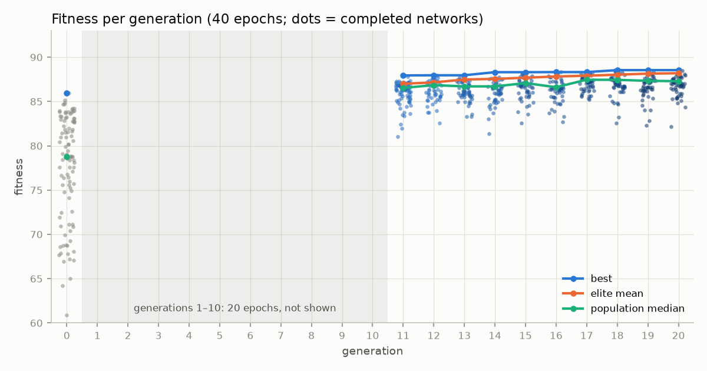
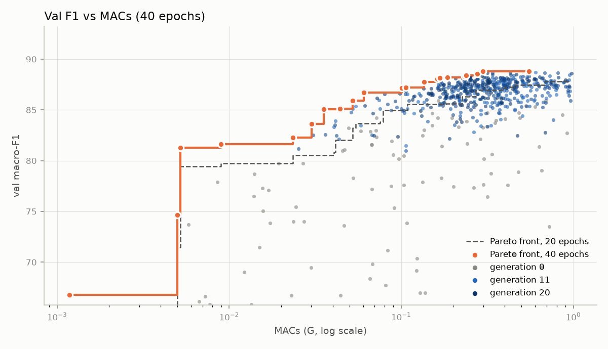
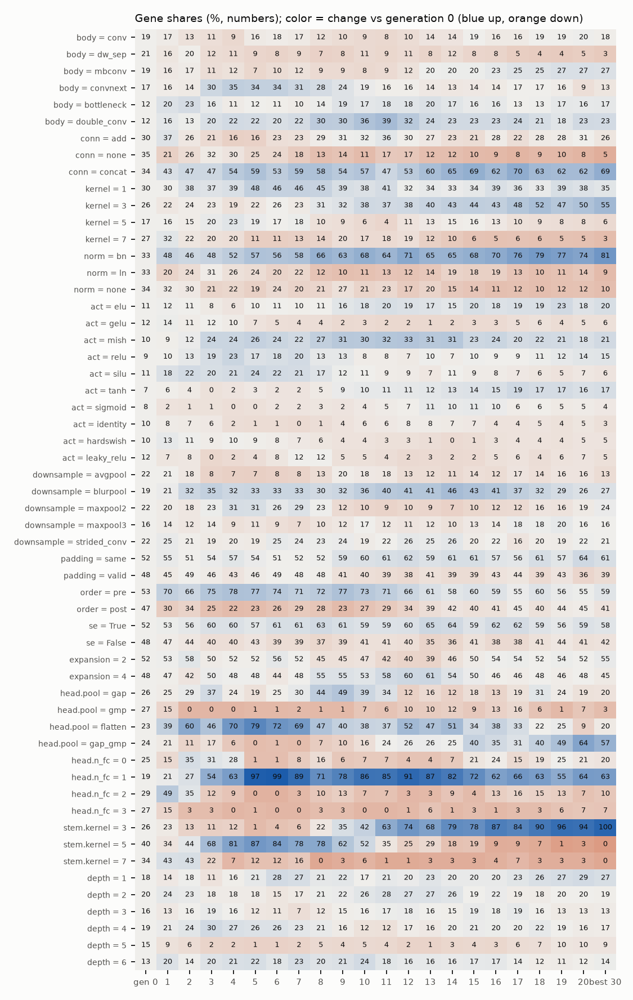
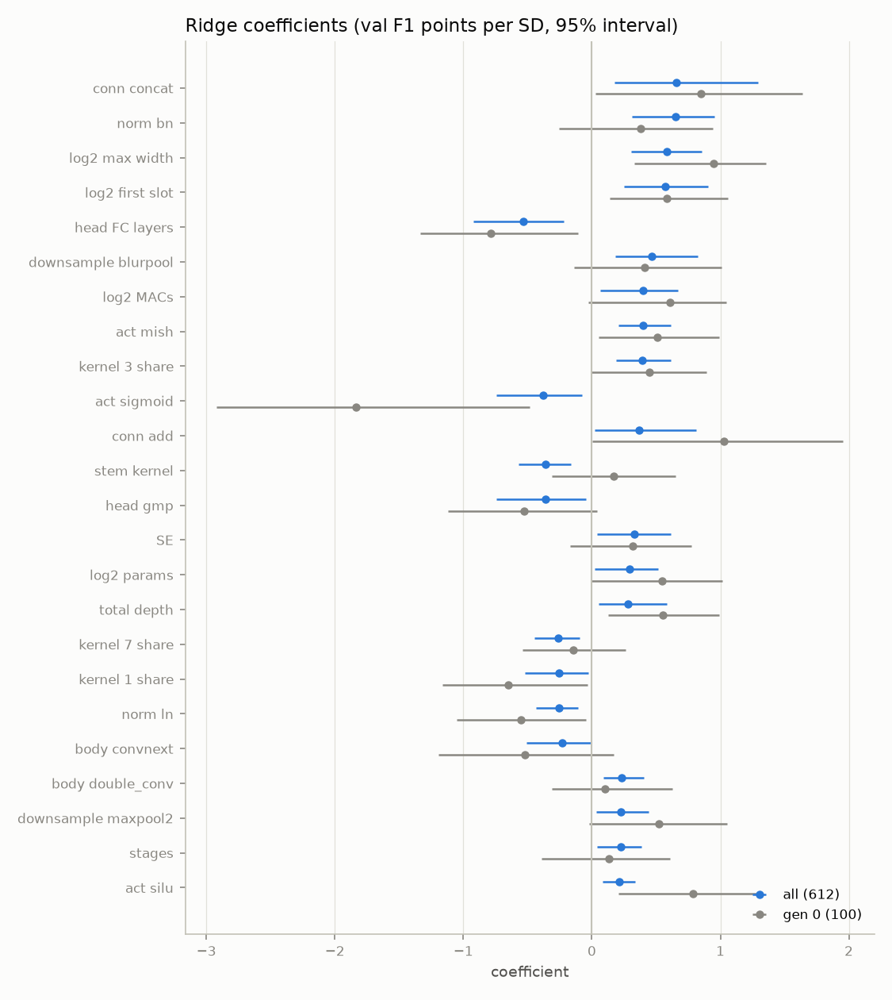

# Search analysis (runs\main_20261024\search, 40 epochs, val only)

1231 records; at 40 epochs 631, completed 612 (generation 0: 100, children: 512); finished generations 0–20. Fitness = 100·val macro-F1 − 0.3·log2(params / 1M) − 0.3·log2(MACs / 0.1G). Test scores are not read.

**Noise:** the training is not bit-deterministic and there is no repeated training at this epoch count, so the noise of one score is not measured here (one network differed by 2.5 points between two 3-epoch runs). Differences below about 1 point are not a ranking.

## 1. Progress per generation

| gen | best | elite mean | median | elite bar | completed / pruned / failed | epochs trained / full | hours | gene entropy |
|---|---|---|---|---|---|---|---|---|
| 0 | 83.64 | — | 74.52 | — | 200 / 0 / 0 | 6000 / 6000 | 6.07 | 0.98 |
| 1 | 85.51 | 81.71 | 81.65 | 80.38 | 41 / 9 / 0 | 921 / 1000 | 1.18 | 0.90 |
| 2 | 85.51 | 83.01 | 82.46 | 82.22 | 43 / 7 / 0 | 936 / 1000 | 1.10 | 0.84 |
| 3 | 85.51 | 83.75 | 83.20 | 82.93 | 45 / 5 / 0 | 964 / 1000 | 1.48 | 0.77 |
| 4 | 85.58 | 84.37 | 83.86 | 83.67 | 47 / 3 / 0 | 972 / 1000 | 1.38 | 0.72 |
| 5 | 86.28 | 84.75 | 84.26 | 84.23 | 48 / 2 / 0 | 984 / 1000 | 1.25 | 0.66 |
| 6 | 86.46 | 85.07 | 84.64 | 84.59 | 47 / 3 / 0 | 978 / 1000 | 1.22 | 0.67 |
| 7 | 86.46 | 85.42 | 84.98 | 84.99 | 44 / 4 / 2 | 934 / 1000 | 1.32 | 0.67 |
| 8 | 86.67 | 85.75 | 85.15 | 85.32 | 48 / 2 / 0 | 981 / 1000 | 1.31 | 0.67 |
| 9 | 86.67 | 86.05 | 85.70 | 85.69 | 48 / 2 / 0 | 987 / 1000 | 1.59 | 0.65 |
| 10 | 86.67 | 86.25 | 85.47 | 85.87 | 49 / 1 / 0 | 989 / 1000 | 1.58 | 0.64 |
| 11 | 87.95 | 87.01 | 86.53 | 86.39 | 49 / 1 / 0 | 3157 / 3240 | 3.96 | 0.65 |
| 12 | 87.96 | 87.16 | 86.85 | 86.85 | 49 / 1 / 0 | 1967 / 2000 | 2.74 | 0.64 |
| 13 | 87.96 | 87.48 | 86.71 | 87.17 | 48 / 2 / 0 | 1912 / 2000 | 3.48 | 0.67 |
| 14 | 88.31 | 87.55 | 86.71 | 87.28 | 49 / 0 / 1 | 1928 / 2000 | 3.03 | 0.65 |
| 15 | 88.31 | 87.69 | 87.08 | 87.46 | 48 / 2 / 0 | 1956 / 2000 | 3.46 | 0.65 |
| 16 | 88.32 | 87.83 | 86.62 | 87.59 | 48 / 1 / 1 | 1896 / 2000 | 3.16 | 0.69 |
| 17 | 88.32 | 87.91 | 87.46 | 87.70 | 48 / 2 / 0 | 1964 / 2000 | 3.25 | 0.65 |
| 18 | 88.55 | 88.03 | 87.45 | 87.80 | 47 / 3 / 0 | 1948 / 2000 | 2.84 | 0.64 |
| 19 | 88.55 | 88.15 | 87.34 | 87.94 | 47 / 1 / 2 | 1897 / 2000 | 2.72 | 0.63 |
| 20 | 88.55 | 88.20 | 87.29 | 87.96 | 48 / 1 / 1 | 1907 / 2000 | 2.68 | 0.63 |

Children not completed: pruned: reach_elite 14, oom 5. Time saved by the stop rules ≈ 0.4 h of 30.3 h (1%; the rest of a cut training estimated at its own speed).

## 2. The best networks (40 epochs)

| # | fitness | val F1 | params | MACs | gen | origin | hash | architecture |
|---|---|---|---|---|---|---|---|---|
| 1 | 88.55 | 88.81 | 0.62M | 0.298G | 18 | crossover | f26817817324fcc9 | s64 mbconv/concat d1 w96 k1 bn | s32 bottleneck/add d2 w128 k3 ln | s16 conv/concat d5 w64 k3 bn | s4 double_conv/concat d2 w96 k1 bn |
| 2 | 88.47 | 88.21 | 0.30M | 0.185G | 20 | mutation | c00c957e623f0814 | s64 mbconv/concat d1 w128 k3 bn | s32 bottleneck/add d6 w48 k3 none | s16 double_conv/concat d4 w64 k3 bn | s4 double_conv/add d2 w192 k1 bn |
| 3 | 88.42 | 88.64 | 0.52M | 0.316G | 18 | crossover | 2505f5933234422d | s64 mbconv/concat d1 w256 k3 bn | s32 bottleneck/add d2 w128 k3 bn | s8 convnext/concat d4 w256 k5 bn | s4 double_conv/concat d3 w192 k1 bn |
| 4 | 88.33 | 88.08 | 0.30M | 0.185G | 19 | mutation | 592e482d4996cc42 | s64 mbconv/concat d1 w128 k3 bn | s32 bottleneck/add d6 w48 k3 none | s16 double_conv/concat d4 w64 k3 bn | s4 double_conv/add d2 w192 k1 bn |
| 5 | 88.32 | 88.33 | 0.43M | 0.233G | 16 | crossover | e343de5ba1d4ce41 | s64 mbconv/concat d1 w96 k1 bn | s32 bottleneck/add d1 w128 k3 ln | s16 conv/concat d5 w64 k3 bn | s4 double_conv/concat d2 w192 k1 bn |
| 6 | 88.31 | 88.67 | 0.68M | 0.338G | 14 | crossover | 6a5c8464bc9cc4db | s64 mbconv/concat d1 w96 k1 bn | s32 bottleneck/add d2 w128 k3 ln | s16 conv/concat d5 w64 k3 bn | s8 convnext/concat d2 w256 k5 bn | s4 double_conv/concat d3 w192 k1 bn |
| 7 | 88.28 | 88.35 | 0.46M | 0.251G | 19 | mutation | 226de9e2505a9c60 | s64 mbconv/add d3 w64 k3 bn | s16 conv/concat d6 w96 k3 bn | s4 double_conv/concat d1 w192 k1 none |
| 8 | 88.26 | 88.36 | 0.53M | 0.240G | 18 | crossover | 93fcb3427dd55995 | s64 mbconv/concat d1 w96 k3 bn | s32 bottleneck/add d2 w128 k3 bn | s16 conv/concat d5 w96 k3 bn | s8 convnext/concat d4 w96 k5 bn | s4 double_conv/concat d3 w192 k1 bn |
| 9 | 88.25 | 88.13 | 0.46M | 0.167G | 18 | crossover | 937354447f9f530e | s64 mbconv/none d1 w128 k3 bn | s32 bottleneck/add d2 w128 k1 bn | s16 conv/concat d4 w96 k3 ln | s8 convnext/concat d4 w96 k5 bn | s4 mbconv/add d3 w24 k1 bn |
| 10 | 88.18 | 88.32 | 0.56M | 0.244G | 17 | mutation | f86137983f4bff95 | s64 mbconv/concat d1 w96 k1 bn | s32 bottleneck/add d1 w128 k3 bn | s16 conv/concat d5 w64 k3 bn | s4 double_conv/concat d2 w96 k1 bn |
| 11 | 88.18 | 88.38 | 0.67M | 0.238G | 19 | crossover | 3ada2f520d8380ac | s64 mbconv/concat d1 w96 k1 bn | s32 bottleneck/add d1 w128 k3 ln | s16 conv/concat d5 w48 k3 bn | s8 convnext/concat d4 w256 k7 bn | s4 double_conv/concat d5 w192 k1 bn |
| 12 | 88.17 | 88.82 | 0.80M | 0.554G | 16 | mutation | 5471c6b4e462f23a | s64 mbconv/add d3 w96 k3 bn | s16 conv/concat d6 w384 k3 ln | s4 bottleneck/concat d2 w192 k1 bn |
| 13 | 88.16 | 88.64 | 0.70M | 0.429G | 17 | mutation | dba9c973246d414a | s64 mbconv/concat d1 w128 k3 bn | s32 conv/add d2 w128 k3 ln | s16 conv/concat d4 w64 k3 bn | s8 convnext/concat d4 w256 k5 bn | s4 conv/concat d3 w192 k1 none |
| 14 | 88.13 | 88.21 | 0.47M | 0.250G | 15 | mutation | 02740aa61dead103 | s64 mbconv/none d1 w128 k3 bn | s32 dw_sep/concat d6 w128 k1 none | s16 double_conv/concat d4 w256 k1 bn | s4 mbconv/add d2 w24 k1 bn |
| 15 | 88.13 | 88.35 | 0.65M | 0.253G | 18 | crossover | e218ad44c35b6f06 | s64 mbconv/concat d1 w96 k1 bn | s32 bottleneck/add d1 w128 k3 bn | s16 conv/concat d5 w256 k3 bn | s8 convnext/concat d3 w256 k7 bn | s4 double_conv/concat d2 w192 k1 none |
| 16 | 88.11 | 88.08 | 0.57M | 0.162G | 20 | crossover | e6c36178268e30a3 | s64 mbconv/none d1 w128 k3 bn | s32 bottleneck/concat d6 w128 k1 none | s16 conv/concat d6 w256 k3 bn | s4 double_conv/concat d1 w192 k1 bn |
| 17 | 88.10 | 88.13 | 0.47M | 0.227G | 17 | mutation | 07dc381e487a62a7 | s64 mbconv/concat d1 w256 k3 bn | s32 bottleneck/add d2 w128 k3 bn | s16 conv/concat d4 w96 k3 bn | s8 convnext/concat d4 w96 k5 bn | s4 double_conv/concat d3 w192 k1 none |
| 18 | 88.10 | 88.38 | 0.65M | 0.294G | 20 | mutation | 513a63ff133a37cb | s64 mbconv/concat d1 w96 k1 bn | s32 bottleneck/add d2 w128 k3 ln | s16 conv/concat d5 w64 k3 bn | s4 double_conv/concat d3 w96 k1 bn |
| 19 | 88.07 | 87.81 | 0.32M | 0.169G | 17 | crossover | e9a1e8addea6056d | s64 mbconv/concat d1 w128 k3 bn | s32 bottleneck/add d6 w48 k3 ln | s16 double_conv/concat d4 w64 k3 bn | s4 double_conv/add d2 w192 k1 bn |
| 20 | 88.06 | 88.56 | 1.15M | 0.276G | 15 | mutation | d4bbed9ddfcb3559 | s64 mbconv/add d1 w96 k3 ln | s32 convnext/add d1 w128 k3 bn | s16 double_conv/concat d4 w256 k3 bn | s8 convnext/concat d6 w96 k7 bn | s4 double_conv/add d6 w192 k1 none |

Spread of the best 20: 0.49 points; neighbouring gaps among the best 30: median 0.01.

### Val F1 / MACs Pareto front (21 networks: none is both cheaper and better)

| MACs | params | val F1 | fitness | gen | hash | architecture |
|---|---|---|---|---|---|---|
| 0.001G | 0.09M | 66.78 | 68.77 | 0 | 0721609ae803649e | s8 mbconv/add d2 w24 k7 none |
| 0.005G | 0.06M | 74.64 | 76.63 | 0 | 4f3571d980c9a3fb | s8 mbconv/add d6 w16 k7 none |
| 0.005G | 0.62M | 81.26 | 82.46 | 11 | 11e7712aa7edd554 | s8 dw_sep/concat d3 w32 k1 bn |
| 0.009G | 0.14M | 81.65 | 83.49 | 11 | 5ec7b956ab0d73fd | s32 conv/none d2 w24 k1 none | s16 mbconv/concat d1 w96 k5 bn | s8 dw_sep/concat d4 w64 k5 none |
| 0.023G | 0.18M | 82.25 | 83.62 | 11 | c35da6d1ce83fe37 | s32 bottleneck/concat d1 w192 k1 bn | s8 bottleneck/none d1 w128 k5 none |
| 0.030G | 0.33M | 83.64 | 84.64 | 14 | 154776cc55183f72 | s16 conv/concat d4 w96 k5 ln | s4 bottleneck/concat d2 w192 k1 bn |
| 0.035G | 0.33M | 85.06 | 85.99 | 16 | 8ed16b9cfd58a85b | s16 double_conv/concat d4 w96 k1 bn | s4 mbconv/none d2 w96 k5 bn |
| 0.044G | 0.11M | 85.12 | 86.43 | 17 | 305e4a96988d4393 | s64 bottleneck/concat d1 w24 k1 bn | s32 bottleneck/concat d2 w128 k3 bn | s8 convnext/concat d3 w96 k1 bn | s4 double_conv/concat d1 w192 k1 none |
| 0.052G | 0.38M | 85.92 | 86.62 | 19 | 844e084432e28116 | s16 conv/concat d6 w96 k3 bn | s4 bottleneck/concat d2 w192 k1 none |
| 0.061G | 0.45M | 86.70 | 87.27 | 16 | f2ffd912f0fafd0e | s32 bottleneck/concat d1 w128 k3 bn | s16 conv/concat d4 w256 k3 bn | s8 convnext/concat d1 w96 k1 bn | s4 double_conv/concat d3 w192 k1 none |
| 0.101G | 0.67M | 87.17 | 87.34 | 19 | fffe7a8fd83017b3 | s32 bottleneck/concat d5 w96 k3 bn | s16 conv/concat d1 w256 k3 bn | s8 convnext/none d3 w96 k1 bn |
| 0.106G | 0.22M | 87.19 | 87.81 | 20 | a47278a27c2f55d7 | s64 mbconv/concat d1 w64 k3 bn | s16 conv/concat d4 w48 k3 bn | s4 double_conv/add d1 w192 k1 bn |
| 0.135G | 0.56M | 87.74 | 87.86 | 15 | deba640d0a980e6d | s64 double_conv/concat d1 w128 k1 bn | s32 bottleneck/add d1 w128 k3 bn | s16 conv/concat d4 w256 k3 bn | s4 double_conv/add d3 w192 k1 none |
| 0.162G | 0.57M | 88.08 | 88.11 | 20 | e6c36178268e30a3 | s64 mbconv/none d1 w128 k3 bn | s32 bottleneck/concat d6 w128 k1 none | s16 conv/concat d6 w256 k3 bn | s4 double_conv/concat d1 w192 k1 bn |
| 0.167G | 0.46M | 88.13 | 88.25 | 18 | 937354447f9f530e | s64 mbconv/none d1 w128 k3 bn | s32 bottleneck/add d2 w128 k1 bn | s16 conv/concat d4 w96 k3 ln | s8 convnext/concat d4 w96 k5 bn | s4 mbconv/add d3 w24 k1 bn |
| 0.185G | 0.30M | 88.21 | 88.47 | 20 | c00c957e623f0814 | s64 mbconv/concat d1 w128 k3 bn | s32 bottleneck/add d6 w48 k3 none | s16 double_conv/concat d4 w64 k3 bn | s4 double_conv/add d2 w192 k1 bn |
| 0.233G | 0.43M | 88.33 | 88.32 | 16 | e343de5ba1d4ce41 | s64 mbconv/concat d1 w96 k1 bn | s32 bottleneck/add d1 w128 k3 ln | s16 conv/concat d5 w64 k3 bn | s4 double_conv/concat d2 w192 k1 bn |
| 0.238G | 0.67M | 88.38 | 88.18 | 19 | 3ada2f520d8380ac | s64 mbconv/concat d1 w96 k1 bn | s32 bottleneck/add d1 w128 k3 ln | s16 conv/concat d5 w48 k3 bn | s8 convnext/concat d4 w256 k7 bn | s4 double_conv/concat d5 w192 k1 bn |
| 0.276G | 1.15M | 88.56 | 88.06 | 15 | d4bbed9ddfcb3559 | s64 mbconv/add d1 w96 k3 ln | s32 convnext/add d1 w128 k3 bn | s16 double_conv/concat d4 w256 k3 bn | s8 convnext/concat d6 w96 k7 bn | s4 double_conv/add d6 w192 k1 none |
| 0.298G | 0.62M | 88.81 | 88.55 | 18 | f26817817324fcc9 | s64 mbconv/concat d1 w96 k1 bn | s32 bottleneck/add d2 w128 k3 ln | s16 conv/concat d5 w64 k3 bn | s4 double_conv/concat d2 w96 k1 bn |
| 0.554G | 0.80M | 88.82 | 88.17 | 16 | 5471c6b4e462f23a | s64 mbconv/add d3 w96 k3 bn | s16 conv/concat d6 w384 k3 ln | s4 bottleneck/concat d2 w192 k1 bn |

## 3. Crossover vs mutation

| origin | children | completed | pruned | failed | median fitness (completed) | ≥ elite bar of its generation | beats its best parent | median child − parent mean |
|---|---|---|---|---|---|---|---|---|
| crossover | 300 | 285 | 11 | 4 | 86.50 | 48 (17%) | 18 (6%) | -1.24 |
| mutation | 200 | 196 | 3 | 1 | 86.61 | 40 (20%) | 24 (12%) | -1.09 |

Origins of the current population (67): crossover 37, mutation 30; of the best 20 so far: crossover 10, mutation 10; of the best 30, by generation: 11: 1, 12: 2, 14: 1, 15: 3, 16: 2, 17: 7, 18: 6, 19: 4, 20: 4

## 4. Gene drift (share in the population's genotypes, active slots)

Generation 0 = the 100 random networks; then the population after each generation; last column the best 30 so far. A share that grows is what selection keeps, but a gene can also ride along with good parents (hitchhiking): section 5 separates that.

| gene | value | gen 0 | 1 | 2 | 3 | 4 | 5 | 6 | 7 | 8 | 9 | 10 | 11 | 12 | 13 | 14 | 15 | 16 | 17 | 18 | 19 | 20 | best 30 |
|---|---|---|---|---|---|---|---|---|---|---|---|---|---|---|---|---|---|---|---|---|---|---|---|
| body | conv | 19 | 17 | 13 | 11 | 9 | 16 | 18 | 17 | 12 | 10 | 9 | 8 | 10 | 14 | 14 | 19 | 16 | 16 | 19 | 19 | 20 | 18 |
| body | dw_sep | 21 | 16 | 20 | 12 | 11 | 9 | 8 | 9 | 7 | 8 | 11 | 9 | 11 | 8 | 12 | 8 | 8 | 5 | 4 | 4 | 5 | 3 |
| body | mbconv | 19 | 16 | 17 | 11 | 12 | 7 | 10 | 12 | 9 | 9 | 8 | 9 | 12 | 20 | 20 | 20 | 23 | 25 | 25 | 27 | 27 | 27 |
| body | convnext | 17 | 16 | 14 | 30 | 35 | 34 | 34 | 31 | 28 | 24 | 19 | 16 | 16 | 14 | 13 | 14 | 14 | 17 | 17 | 16 | 9 | 13 |
| body | bottleneck | 12 | 20 | 23 | 16 | 11 | 12 | 11 | 10 | 14 | 19 | 17 | 18 | 18 | 20 | 17 | 16 | 16 | 13 | 13 | 17 | 16 | 17 |
| body | double_conv | 12 | 16 | 13 | 20 | 22 | 22 | 20 | 22 | 30 | 30 | 36 | 39 | 32 | 24 | 23 | 23 | 23 | 24 | 21 | 18 | 23 | 23 |
| conn | add | 30 | 37 | 26 | 21 | 16 | 16 | 23 | 23 | 29 | 31 | 32 | 36 | 30 | 27 | 23 | 21 | 28 | 22 | 28 | 28 | 31 | 26 |
| conn | none | 35 | 21 | 26 | 32 | 30 | 25 | 24 | 18 | 13 | 14 | 11 | 17 | 17 | 12 | 12 | 10 | 9 | 8 | 9 | 10 | 8 | 5 |
| conn | concat | 34 | 43 | 47 | 47 | 54 | 59 | 53 | 59 | 58 | 54 | 57 | 47 | 53 | 60 | 65 | 69 | 62 | 70 | 63 | 62 | 62 | 69 |
| kernel | 1 | 30 | 30 | 38 | 37 | 39 | 48 | 46 | 46 | 45 | 39 | 38 | 41 | 32 | 34 | 33 | 34 | 39 | 36 | 33 | 39 | 38 | 35 |
| kernel | 3 | 26 | 22 | 24 | 23 | 19 | 22 | 26 | 23 | 31 | 32 | 38 | 37 | 38 | 40 | 43 | 44 | 43 | 48 | 52 | 47 | 50 | 55 |
| kernel | 5 | 17 | 16 | 15 | 20 | 23 | 19 | 17 | 18 | 10 | 9 | 6 | 4 | 11 | 13 | 15 | 16 | 13 | 10 | 9 | 8 | 8 | 6 |
| kernel | 7 | 27 | 32 | 22 | 20 | 20 | 11 | 11 | 13 | 14 | 20 | 17 | 18 | 19 | 12 | 10 | 6 | 5 | 6 | 6 | 5 | 5 | 3 |
| norm | bn | 33 | 48 | 46 | 48 | 52 | 57 | 56 | 58 | 66 | 63 | 68 | 64 | 71 | 65 | 65 | 68 | 70 | 76 | 79 | 77 | 74 | 81 |
| norm | ln | 33 | 20 | 24 | 31 | 26 | 24 | 20 | 22 | 12 | 10 | 11 | 13 | 12 | 14 | 19 | 18 | 19 | 13 | 10 | 11 | 14 | 9 |
| norm | none | 34 | 32 | 30 | 21 | 22 | 19 | 24 | 20 | 21 | 27 | 21 | 23 | 17 | 20 | 15 | 14 | 11 | 12 | 10 | 12 | 12 | 10 |
| act | elu | 11 | 12 | 11 | 8 | 6 | 10 | 11 | 10 | 11 | 16 | 18 | 20 | 19 | 17 | 15 | 20 | 18 | 19 | 19 | 23 | 18 | 20 |
| act | gelu | 12 | 14 | 11 | 12 | 10 | 7 | 5 | 4 | 4 | 2 | 3 | 2 | 2 | 1 | 2 | 3 | 3 | 5 | 6 | 4 | 5 | 6 |
| act | mish | 10 | 9 | 12 | 24 | 24 | 26 | 24 | 22 | 27 | 31 | 30 | 32 | 33 | 31 | 31 | 23 | 24 | 20 | 22 | 21 | 18 | 21 |
| act | relu | 9 | 10 | 13 | 19 | 23 | 17 | 18 | 20 | 13 | 13 | 8 | 8 | 7 | 10 | 7 | 10 | 9 | 9 | 11 | 12 | 14 | 15 |
| act | silu | 11 | 18 | 22 | 20 | 21 | 24 | 22 | 21 | 17 | 12 | 11 | 9 | 9 | 7 | 11 | 9 | 8 | 7 | 6 | 5 | 7 | 6 |
| act | tanh | 7 | 6 | 4 | 0 | 2 | 3 | 2 | 2 | 5 | 9 | 10 | 11 | 11 | 12 | 13 | 14 | 15 | 19 | 17 | 17 | 16 | 17 |
| act | sigmoid | 8 | 2 | 1 | 1 | 0 | 0 | 2 | 2 | 3 | 2 | 4 | 5 | 7 | 11 | 10 | 11 | 10 | 6 | 6 | 5 | 5 | 4 |
| act | identity | 10 | 8 | 7 | 6 | 2 | 1 | 1 | 0 | 1 | 4 | 6 | 6 | 8 | 8 | 7 | 7 | 4 | 4 | 5 | 4 | 5 | 3 |
| act | hardswish | 10 | 13 | 11 | 9 | 10 | 9 | 8 | 7 | 6 | 4 | 4 | 3 | 3 | 1 | 0 | 1 | 3 | 4 | 4 | 4 | 5 | 5 |
| act | leaky_relu | 12 | 7 | 8 | 0 | 2 | 4 | 8 | 12 | 12 | 5 | 5 | 4 | 2 | 3 | 2 | 2 | 5 | 6 | 4 | 6 | 7 | 5 |
| downsample | avgpool | 22 | 21 | 18 | 8 | 7 | 7 | 8 | 8 | 13 | 20 | 18 | 18 | 13 | 12 | 11 | 14 | 12 | 17 | 14 | 16 | 16 | 13 |
| downsample | blurpool | 19 | 21 | 32 | 35 | 32 | 33 | 33 | 33 | 30 | 32 | 36 | 40 | 41 | 41 | 46 | 43 | 41 | 37 | 32 | 29 | 26 | 27 |
| downsample | maxpool2 | 22 | 20 | 18 | 23 | 31 | 31 | 26 | 29 | 23 | 12 | 10 | 9 | 10 | 9 | 7 | 10 | 12 | 12 | 16 | 16 | 19 | 24 |
| downsample | maxpool3 | 16 | 14 | 12 | 14 | 9 | 11 | 9 | 7 | 10 | 12 | 17 | 12 | 11 | 12 | 10 | 13 | 14 | 18 | 18 | 20 | 16 | 16 |
| downsample | strided_conv | 22 | 25 | 21 | 19 | 20 | 19 | 25 | 24 | 23 | 24 | 19 | 22 | 26 | 25 | 26 | 20 | 22 | 16 | 20 | 19 | 22 | 21 |
| padding | same | 52 | 55 | 51 | 54 | 57 | 54 | 51 | 52 | 52 | 59 | 60 | 61 | 62 | 59 | 61 | 61 | 57 | 56 | 61 | 57 | 64 | 61 |
| padding | valid | 48 | 45 | 49 | 46 | 43 | 46 | 49 | 48 | 48 | 41 | 40 | 39 | 38 | 41 | 39 | 39 | 43 | 44 | 39 | 43 | 36 | 39 |
| order | pre | 53 | 70 | 66 | 75 | 78 | 77 | 74 | 71 | 72 | 77 | 73 | 71 | 66 | 61 | 58 | 60 | 59 | 55 | 60 | 56 | 55 | 59 |
| order | post | 47 | 30 | 34 | 25 | 22 | 23 | 26 | 29 | 28 | 23 | 27 | 29 | 34 | 39 | 42 | 40 | 41 | 45 | 40 | 44 | 45 | 41 |
| se | True | 52 | 53 | 56 | 60 | 60 | 57 | 61 | 61 | 63 | 61 | 59 | 59 | 60 | 65 | 64 | 59 | 62 | 62 | 59 | 56 | 59 | 58 |
| se | False | 48 | 47 | 44 | 40 | 40 | 43 | 39 | 39 | 37 | 39 | 41 | 41 | 40 | 35 | 36 | 41 | 38 | 38 | 41 | 44 | 41 | 42 |
| expansion | 2 | 52 | 53 | 58 | 50 | 52 | 52 | 56 | 52 | 45 | 45 | 47 | 42 | 40 | 39 | 46 | 50 | 54 | 54 | 52 | 54 | 52 | 55 |
| expansion | 4 | 48 | 47 | 42 | 50 | 48 | 48 | 44 | 48 | 55 | 55 | 53 | 58 | 60 | 61 | 54 | 50 | 46 | 46 | 48 | 46 | 48 | 45 |
| head.pool | gap | 26 | 25 | 29 | 37 | 24 | 19 | 25 | 30 | 44 | 49 | 39 | 34 | 12 | 16 | 12 | 18 | 13 | 19 | 31 | 24 | 19 | 20 |
| head.pool | gmp | 27 | 15 | 0 | 0 | 0 | 1 | 1 | 2 | 1 | 1 | 7 | 6 | 10 | 10 | 12 | 9 | 13 | 16 | 6 | 1 | 7 | 3 |
| head.pool | flatten | 23 | 39 | 60 | 46 | 70 | 79 | 72 | 69 | 47 | 40 | 38 | 37 | 52 | 47 | 51 | 34 | 38 | 33 | 22 | 25 | 9 | 20 |
| head.pool | gap_gmp | 24 | 21 | 11 | 17 | 6 | 0 | 1 | 0 | 7 | 10 | 16 | 24 | 26 | 26 | 25 | 40 | 35 | 31 | 40 | 49 | 64 | 57 |
| head.n_fc | 0 | 25 | 15 | 35 | 31 | 28 | 1 | 1 | 8 | 16 | 6 | 7 | 7 | 4 | 4 | 7 | 21 | 24 | 15 | 19 | 25 | 21 | 20 |
| head.n_fc | 1 | 19 | 21 | 27 | 54 | 63 | 97 | 99 | 89 | 71 | 78 | 86 | 85 | 91 | 87 | 82 | 72 | 62 | 66 | 63 | 55 | 64 | 63 |
| head.n_fc | 2 | 29 | 49 | 35 | 12 | 9 | 0 | 0 | 3 | 10 | 13 | 7 | 7 | 3 | 3 | 9 | 4 | 13 | 16 | 15 | 13 | 7 | 10 |
| head.n_fc | 3 | 27 | 15 | 3 | 3 | 0 | 1 | 0 | 0 | 3 | 3 | 0 | 0 | 1 | 6 | 1 | 3 | 1 | 3 | 3 | 6 | 7 | 7 |
| stem.kernel | 3 | 26 | 23 | 13 | 11 | 12 | 1 | 4 | 6 | 22 | 35 | 42 | 63 | 74 | 68 | 79 | 78 | 87 | 84 | 90 | 96 | 94 | 100 |
| stem.kernel | 5 | 40 | 34 | 44 | 68 | 81 | 87 | 84 | 78 | 78 | 62 | 52 | 35 | 25 | 29 | 18 | 19 | 9 | 9 | 7 | 1 | 3 | 0 |
| stem.kernel | 7 | 34 | 43 | 43 | 22 | 7 | 12 | 12 | 16 | 0 | 3 | 6 | 1 | 1 | 3 | 3 | 3 | 4 | 7 | 3 | 3 | 3 | 0 |
| depth | 1 | 18 | 14 | 18 | 11 | 16 | 21 | 28 | 27 | 21 | 22 | 17 | 21 | 20 | 23 | 20 | 20 | 20 | 23 | 26 | 27 | 29 | 27 |
| depth | 2 | 20 | 24 | 23 | 18 | 18 | 18 | 15 | 17 | 21 | 22 | 26 | 28 | 27 | 27 | 26 | 19 | 22 | 19 | 18 | 20 | 20 | 19 |
| depth | 3 | 16 | 13 | 16 | 19 | 16 | 12 | 11 | 7 | 12 | 15 | 16 | 17 | 18 | 16 | 15 | 19 | 18 | 19 | 16 | 13 | 13 | 13 |
| depth | 4 | 19 | 21 | 24 | 30 | 27 | 26 | 26 | 23 | 21 | 16 | 12 | 12 | 17 | 16 | 20 | 21 | 20 | 20 | 22 | 19 | 16 | 17 |
| depth | 5 | 15 | 9 | 6 | 2 | 2 | 1 | 1 | 2 | 5 | 4 | 5 | 4 | 2 | 1 | 3 | 4 | 3 | 6 | 7 | 10 | 10 | 9 |
| depth | 6 | 13 | 20 | 14 | 20 | 21 | 22 | 18 | 23 | 20 | 21 | 24 | 18 | 16 | 16 | 16 | 17 | 17 | 14 | 12 | 11 | 12 | 14 |

## 5. Gene effects (target: val macro-F1, points)

Features of the network actually built (canonical form), as in analyze_gen0: "body convnext" = some stage has it, "kernel 1 share" = the share of the active stages with kernel 1. * = the 95% bootstrap interval excludes 0; many intervals at once, so a few * are expected by chance. None of it is causal.

- **gen 0**: the 100 random networks, no selection, but few;
- **all**: the 612 completed networks at 40 epochs; most are children of elites, so a gene can look good because it sits in good networks (hitchhiking) or because later generations are better overall;
- **mutation pairs**: 196 children vs their parent (median 8 features changed per pair). Every pair's change minus the median change of all pairs (-1.08: the regression to the mean of a selected parent), signed by the direction of the flip: + = having it is better. Numeric: Spearman of the feature's change with the F1 change.

### One feature at a time

| feature (binary: any stage) | networks with it (all) | all: with − without | gen 0: with − without | mutation pairs: flips on / off | mutation pairs: effect |
|---|---|---|---|---|---|
| no norm anywhere | 12 | -13.52 (-21.45 … -7.65) * | -5.11 (-12.66 … +1.58) | — | — |
| norm bn | 569 | +11.89 (+9.41 … +14.55) * | +4.91 (+1.07 … +8.73) * | — | — |
| conn concat | 560 | +9.26 (+5.88 … +13.35) * | +4.68 (+0.45 … +10.13) * | 0 / 7 | +1.15 (+0.34 … +1.92) * |
| SE | 581 | +8.73 (+5.68 … +11.61) * | +3.98 (+0.19 … +7.60) * | — | — |
| valid padding | 10 | -5.40 (-8.93 … -1.95) * | -1.39 (-4.52 … +2.06) | — | — |
| act mish | 407 | +4.43 (+3.24 … +5.72) * | +4.94 (+1.70 … +8.27) * | 4 / 15 | +0.31 (-0.64 … +1.26) |
| body double_conv | 410 | +4.19 (+3.03 … +5.48) * | +3.78 (+0.46 … +7.43) * | 4 / 29 | +0.88 (+0.43 … +1.31) * |
| downsample blurpool | 424 | +3.71 (+2.50 … +5.09) * | +3.69 (+0.36 … +7.32) * | 3 / 16 | +1.12 (+0.60 … +1.60) * |
| head gmp | 75 | -3.53 (-6.42 … -1.35) * | -3.91 (-10.79 … +1.11) | 4 / 1 | -0.14 (-0.82 … +0.57) |
| conn add | 451 | +2.86 (+1.52 … +4.40) * | +4.15 (+0.23 … +8.55) * | 7 / 14 | +0.58 (-0.12 … +1.44) |
| act tanh | 299 | +2.78 (+1.95 … +3.70) * | +2.59 (-1.56 … +6.72) | 3 / 19 | +0.36 (-0.28 … +1.06) |
| pre-activation | 474 | +2.70 (+1.52 … +3.89) * | +1.35 (-2.96 … +4.79) | 7 / 10 | +0.04 (-0.63 … +0.72) |
| act elu | 351 | +2.19 (+1.26 … +3.10) * | -2.69 (-10.04 … +2.70) | 6 / 17 | +0.19 (-0.29 … +0.79) |
| body bottleneck | 346 | +2.17 (+1.24 … +3.13) * | +1.80 (-4.47 … +6.30) | 5 / 25 | +0.27 (-0.29 … +0.85) |
| downsample strided_conv | 391 | +2.14 (+1.16 … +3.07) * | -0.36 (-6.44 … +4.15) | 5 / 26 | +0.50 (+0.01 … +1.02) * |
| body mbconv | 389 | +2.03 (+1.08 … +2.95) * | -1.07 (-5.93 … +3.03) | 4 / 21 | +0.88 (+0.36 … +1.49) * |
| act relu | 211 | +1.68 (+0.94 … +2.45) * | +4.21 (+0.84 … +7.75) * | 14 / 18 | +0.71 (+0.10 … +1.30) * |
| body conv | 316 | +1.37 (+0.50 … +2.31) * | +2.11 (-1.48 … +6.22) | 8 / 12 | +0.48 (-0.21 … +1.20) |
| head flatten | 205 | +1.34 (+0.58 … +2.13) * | +5.22 (+1.80 … +8.85) * | 5 / 6 | +0.70 (-0.19 … +1.91) |
| downsample maxpool3 | 256 | +1.21 (+0.19 … +2.10) * | -1.15 (-7.83 … +3.88) | 9 / 10 | -0.15 (-1.01 … +0.70) |
| act silu | 189 | +1.20 (+0.44 … +2.01) * | +4.79 (+1.28 … +8.30) * | 7 / 10 | +0.15 (-0.22 … +0.52) |
| act hardswish | 86 | -1.05 (-3.52 … +0.68) | +0.08 (-8.37 … +5.83) | 10 / 4 | +0.67 (-0.11 … +1.51) |
| body convnext | 306 | +1.00 (+0.03 … +1.92) * | -0.40 (-5.64 … +3.54) | 17 / 13 | -0.08 (-0.42 … +0.32) |
| downsample maxpool2 | 225 | +0.90 (+0.09 … +1.72) * | +3.75 (+0.39 … +7.37) * | 16 / 10 | +0.08 (-0.25 … +0.43) |
| head gap_gmp | 200 | +0.85 (+0.02 … +1.70) * | +0.65 (-2.78 … +4.27) | 5 / 8 | -0.51 (-1.57 … +0.33) |
| downsample avgpool | 157 | -0.73 (-1.76 … +0.28) | +1.23 (-2.38 … +5.15) | 9 / 5 | -0.62 (-1.17 … -0.14) * |
| norm ln | 324 | -0.63 (-1.54 … +0.26) | -1.09 (-5.36 … +2.64) | 27 / 12 | -0.13 (-0.62 … +0.36) |
| head gap | 132 | -0.62 (-1.90 … +0.51) | -1.42 (-6.15 … +2.88) | 6 / 5 | -0.03 (-0.44 … +0.39) |
| act gelu | 87 | -0.62 (-1.71 … +0.47) | +3.27 (+0.14 … +6.71) * | 7 / 5 | -0.02 (-0.61 … +0.51) |
| body dw_sep | 190 | -0.57 (-1.80 … +0.46) | +1.49 (-3.55 … +5.44) | 7 / 5 | -0.04 (-1.22 … +1.12) |
| act identity | 136 | -0.57 (-2.21 … +0.71) | -3.63 (-11.53 … +1.97) | 6 / 9 | -0.15 (-0.50 … +0.21) |
| act leaky_relu | 111 | -0.47 (-1.59 … +0.61) | +2.24 (-1.24 … +5.89) | 5 / 5 | +1.05 (-0.01 … +2.35) |
| act sigmoid | 165 | -0.28 (-1.73 … +0.93) | -10.14 (-21.20 … -2.14) * | 5 / 9 | +0.25 (-0.37 … +0.79) |

| numeric feature | all: Spearman | gen 0: Spearman | mutation pairs: changed | mutation pairs: Spearman of changes |
|---|---|---|---|---|
| stages | +0.52 (+0.46 … +0.59) * | +0.45 (+0.26 … +0.60) * | 75 | +0.27 (+0.05 … +0.46) * |
| log2 MACs | +0.49 (+0.42 … +0.55) * | +0.53 (+0.36 … +0.67) * | 194 | +0.46 (+0.34 … +0.56) * |
| log2 first slot | +0.48 (+0.42 … +0.53) * | +0.41 (+0.23 … +0.57) * | 23 | +0.61 (+0.31 … +0.80) * |
| total depth | +0.40 (+0.33 … +0.47) * | +0.43 (+0.24 … +0.59) * | 117 | +0.32 (+0.14 … +0.47) * |
| kernel 3 share | +0.34 (+0.26 … +0.41) * | +0.12 (-0.08 … +0.30) | 93 | +0.12 (-0.11 … +0.34) |
| log2 params | +0.33 (+0.25 … +0.40) * | +0.50 (+0.33 … +0.64) * | 196 | +0.40 (+0.26 … +0.52) * |
| stem kernel | -0.31 (-0.39 … -0.23) * | +0.11 (-0.09 … +0.30) | 25 | -0.21 (-0.60 … +0.24) |
| log2 max width | +0.30 (+0.22 … +0.38) * | +0.39 (+0.19 … +0.58) * | 43 | +0.48 (+0.17 … +0.71) * |
| stem width | +0.19 (+0.11 … +0.27) * | +0.07 (-0.12 … +0.27) | 26 | -0.25 (-0.56 … +0.15) |
| kernel 7 share | -0.18 (-0.26 … -0.10) * | +0.10 (-0.11 … +0.29) | 54 | +0.06 (-0.28 … +0.37) |
| head FC layers | -0.17 (-0.25 … -0.08) * | -0.04 (-0.22 … +0.15) | 28 | -0.23 (-0.54 … +0.14) |
| mean kernel | -0.13 (-0.21 … -0.04) * | +0.08 (-0.13 … +0.29) | 108 | +0.16 (-0.04 … +0.35) |
| kernel 5 share | -0.04 (-0.12 … +0.04) | +0.08 (-0.11 … +0.28) | 55 | +0.04 (-0.21 … +0.30) |
| kernel 1 share | -0.03 (-0.12 … +0.06) | -0.02 (-0.23 … +0.19) | 101 | -0.23 (-0.43 … -0.01) * |

### All together: ridge regression (log2 params and MACs among the features, so a gene's effect is beyond the size it brings)

λ by leave-one-out error: all λ = 300 (LOO R² 0.48), gen 0 λ = 100 (LOO R² 0.17), mutation pairs (on the changes) λ = 100 (LOO R² 0.34). Coefficient = points per one standard deviation of the feature.

| feature | all | gen 0 | mutation pairs |
|---|---|---|---|
| conn concat | +0.66 (+0.17 … +1.29) * | +0.85 (+0.03 … +1.64) * | +0.04 (-0.01 … +0.10) |
| norm bn | +0.65 (+0.31 … +0.95) * | +0.38 (-0.25 … +0.94) | — |
| log2 max width | +0.58 (+0.31 … +0.85) * | +0.95 (+0.33 … +1.35) * | +0.12 (+0.01 … +0.21) * |
| log2 first slot | +0.57 (+0.25 … +0.90) * | +0.58 (+0.14 … +1.06) * | +0.17 (+0.05 … +0.25) * |
| head FC layers | -0.53 (-0.92 … -0.22) * | -0.79 (-1.34 … -0.11) * | -0.14 (-0.23 … -0.03) * |
| downsample blurpool | +0.47 (+0.18 … +0.83) * | +0.41 (-0.14 … +1.01) | +0.14 (+0.06 … +0.21) * |
| log2 MACs | +0.40 (+0.07 … +0.67) * | +0.61 (-0.03 … +1.05) | +0.21 (+0.13 … +0.28) * |
| act mish | +0.40 (+0.21 … +0.62) * | +0.51 (+0.05 … +0.99) * | -0.03 (-0.16 … +0.09) |
| kernel 3 share | +0.39 (+0.19 … +0.61) * | +0.45 (-0.00 … +0.89) | +0.14 (+0.03 … +0.24) * |
| act sigmoid | -0.38 (-0.74 … -0.08) * | -1.83 (-2.92 … -0.48) * | -0.01 (-0.10 … +0.09) |
| conn add | +0.37 (+0.02 … +0.81) * | +1.03 (+0.00 … +1.95) * | +0.06 (-0.03 … +0.15) |
| stem kernel | -0.36 (-0.57 … -0.16) * | +0.17 (-0.31 … +0.65) | -0.07 (-0.15 … +0.01) |
| head gmp | -0.36 (-0.74 … -0.05) * | -0.53 (-1.12 … +0.04) | -0.00 (-0.07 … +0.06) |
| SE | +0.33 (+0.04 … +0.62) * | +0.32 (-0.17 … +0.77) | — |
| log2 params | +0.29 (+0.02 … +0.51) * | +0.54 (-0.01 … +1.01) | +0.18 (+0.09 … +0.28) * |
| total depth | +0.28 (+0.05 … +0.58) * | +0.55 (+0.13 … +0.99) * | +0.10 (+0.02 … +0.16) * |
| kernel 7 share | -0.26 (-0.44 … -0.09) * | -0.14 (-0.54 … +0.26) | -0.04 (-0.10 … +0.01) |
| kernel 1 share | -0.26 (-0.52 … -0.03) * | -0.65 (-1.16 … -0.03) * | -0.10 (-0.18 … +0.02) |
| norm ln | -0.26 (-0.43 … -0.10) * | -0.55 (-1.05 … -0.04) * | -0.02 (-0.10 … +0.06) |
| body convnext | -0.23 (-0.51 … -0.01) * | -0.52 (-1.19 … +0.17) | -0.02 (-0.08 … +0.05) |
| body double_conv | +0.23 (+0.09 … +0.40) * | +0.10 (-0.31 … +0.63) | +0.19 (+0.10 … +0.26) * |
| downsample maxpool2 | +0.23 (+0.03 … +0.44) * | +0.52 (-0.02 … +1.05) | +0.02 (-0.05 … +0.09) |
| stages | +0.23 (+0.04 … +0.39) * | +0.13 (-0.39 … +0.61) | +0.09 (+0.03 … +0.18) * |
| act silu | +0.21 (+0.09 … +0.34) * | +0.79 (+0.21 … +1.33) * | +0.02 (-0.03 … +0.08) |
| act identity | -0.21 (-0.55 … +0.07) | -0.95 (-1.86 … -0.04) * | -0.00 (-0.06 … +0.06) |
| head flatten | +0.20 (+0.07 … +0.36) * | +0.51 (+0.05 … +0.95) * | +0.02 (-0.04 … +0.09) |
| no norm anywhere | -0.18 (-0.64 … +0.17) | -0.41 (-0.97 … +0.20) | — |
| act relu | +0.15 (+0.02 … +0.28) * | +0.50 (+0.04 … +0.91) * | +0.12 (+0.01 … +0.24) * |
| act tanh | +0.13 (-0.05 … +0.36) | +0.30 (-0.29 … +0.90) | -0.01 (-0.11 … +0.09) |
| kernel 5 share | +0.13 (-0.06 … +0.34) | +0.45 (-0.20 … +1.04) | -0.02 (-0.09 … +0.04) |
| valid padding | -0.11 (-0.29 … +0.05) | +0.04 (-0.44 … +0.64) | — |
| stem width | +0.11 (-0.05 … +0.29) | +0.23 (-0.19 … +0.64) | -0.03 (-0.11 … +0.06) |
| body dw_sep | -0.11 (-0.39 … +0.11) | +0.27 (-0.22 … +0.64) | -0.04 (-0.14 … +0.08) |
| head gap_gmp | +0.11 (-0.02 … +0.27) | +0.19 (-0.26 … +0.65) | -0.03 (-0.10 … +0.03) |
| act hardswish | -0.08 (-0.47 … +0.19) | -0.25 (-1.14 … +0.52) | +0.09 (-0.02 … +0.18) |
| body mbconv | +0.07 (-0.28 … +0.34) | -0.28 (-1.05 … +0.46) | +0.05 (-0.04 … +0.14) |
| head gap | -0.07 (-0.21 … +0.06) | -0.14 (-0.63 … +0.35) | +0.01 (-0.04 … +0.07) |
| downsample avgpool | -0.06 (-0.24 … +0.16) | +0.13 (-0.46 … +0.81) | -0.05 (-0.10 … +0.01) |
| act gelu | +0.06 (-0.09 … +0.20) | +0.55 (-0.06 … +1.10) | +0.00 (-0.08 … +0.08) |
| mean kernel | -0.05 (-0.21 … +0.12) | +0.25 (-0.17 … +0.63) | +0.01 (-0.05 … +0.05) |
| pre-activation | +0.05 (-0.17 … +0.24) | +0.05 (-0.45 … +0.49) | -0.03 (-0.11 … +0.06) |
| downsample strided_conv | -0.04 (-0.25 … +0.13) | -0.35 (-1.08 … +0.38) | -0.02 (-0.10 … +0.05) |
| body conv | +0.04 (-0.15 … +0.29) | +0.03 (-0.46 … +0.67) | +0.06 (-0.02 … +0.15) |
| act elu | -0.04 (-0.33 … +0.18) | -0.63 (-1.56 … +0.24) | -0.06 (-0.13 … +0.03) |
| downsample maxpool3 | +0.02 (-0.18 … +0.20) | -0.42 (-1.09 … +0.25) | -0.03 (-0.12 … +0.06) |
| act leaky_relu | -0.02 (-0.17 … +0.15) | +0.05 (-0.38 … +0.58) | +0.07 (-0.01 … +0.15) |
| body bottleneck | -0.00 (-0.32 … +0.24) | -0.28 (-1.25 … +0.63) | +0.02 (-0.10 … +0.14) |

## 6. The best networks in detail

### Per-class val F1 (the best 10 by fitness)

| class | gen 0 median | all median | best 10 mean | best 10 min | best network |
|---|---|---|---|---|---|
| mountain | 60.7 | 70.5 | 73.7 | 72.4 | 73.7 |
| desert_sand | 61.4 | 72.5 | 75.9 | 74.8 | 77.1 |
| Car | 62.5 | 73.8 | 76.1 | 75.2 | 77.0 |
| ocean | 56.4 | 71.6 | 76.1 | 74.5 | 78.0 |
| Truck | 64.9 | 76.5 | 78.9 | 78.1 | 80.4 |
| Boat | 57.1 | 74.5 | 79.1 | 77.3 | 78.7 |
| Airplane | 64.5 | 81.1 | 84.3 | 83.0 | 85.1 |
| forest_broadleaf | 86.2 | 90.4 | 91.5 | 90.5 | 91.4 |
| NORM | 93.7 | 97.3 | 97.7 | 97.3 | 97.7 |
| TUM | 94.0 | 97.2 | 97.7 | 97.2 | 97.8 |
| dog | 93.8 | 97.8 | 98.2 | 97.5 | 98.5 |
| wild | 95.1 | 98.0 | 98.4 | 98.1 | 98.3 |
| cat | 96.3 | 99.1 | 99.4 | 99.2 | 99.4 |
| LYM | 98.9 | 99.4 | 99.4 | 99.3 | 99.3 |
| ADI | 98.3 | 99.4 | 99.6 | 99.3 | 99.7 |

### Stage motifs (body/connection, kernel, norm) in the best 30 vs all completed

| motif | best 30 stages | share | all share | ratio |
|---|---|---|---|---|
| conv/concat k3 bn | 18 | 14% | 5.6% | 2.5× |
| double_conv/concat k1 bn | 13 | 10% | 5.2% | 2.0× |
| mbconv/concat k3 bn | 11 | 9% | 4.3% | 2.0× |
| mbconv/concat k1 bn | 10 | 8% | 2.5% | 3.2× |
| bottleneck/add k3 bn | 8 | 6% | 2.4% | 2.7× |
| convnext/concat k5 bn | 8 | 6% | 2.4% | 2.6× |
| bottleneck/add k3 ln | 6 | 5% | 1.4% | 3.3× |
| double_conv/concat k3 bn | 6 | 5% | 2.6% | 1.8× |
| double_conv/concat k1 none | 6 | 5% | 3.4% | 1.4× |
| mbconv/none k3 bn | 5 | 4% | 1.7% | 2.4× |
| mbconv/add k3 bn | 4 | 3% | 1.8% | 1.7× |
| convnext/concat k7 bn | 4 | 3% | 3.2% | 1.0× |
| double_conv/add k1 bn | 3 | 2% | 2.4% | 1.0× |
| mbconv/add k1 bn | 3 | 2% | 1.9% | 1.2× |
| convnext/concat k1 bn | 3 | 2% | 1.6% | 1.4× |

### Stage layouts (active slots) in the best 30

| layout | best 30 | all |
|---|---|---|
| s64 s32 s16 s4 | 11 | 110 |
| s64 s32 s16 s8 s4 | 11 | 179 |
| s64 s16 s4 | 4 | 62 |
| s64 s32 s8 s4 | 2 | 21 |
| s64 s32 s16 s8 | 2 | 33 |

Activations in the best 30 (stages): mish 27, elu 25, tanh 21, relu 19, silu 7, gelu 7, hardswish 6, leaky_relu 6, sigmoid 5, identity 4; kernels: k1 45, k3 70, k5 8, k7 4

